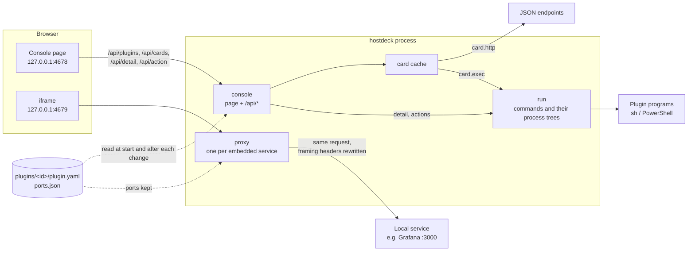

# Architecture

[简体中文](ARCHITECTURE.zh-CN.md)

hostdeck is one Go program. It serves a web console on 127.0.0.1, reads plugins from a folder when it starts and after each change on its plugins page, and re-serves each embedded web UI on a port of its own. There is no database server. Reads happen when the page asks, except for the disk-history plugin's explicitly enabled hourly scans.

## The pieces

Startup, in `main.go`:

1. Pick the folder: `--dir`, else `HOSTDECK_DIR`, else `~/.config/hostdeck` on macOS or `%LOCALAPPDATA%\hostdeck` on Windows.
2. Load every `plugins/<id>/plugin.yaml`. A plugin that does not load is set aside with its error and shown later as an error card; the others load. The card uses the name written in the manifest when that name can be read. A variable that is not set is named on its own, and the file path is kept apart from the sentence.
3. Listen on `--addr` (127.0.0.1 only, 4678 by default).
4. Give each plugin with `page.proxy` a forwarding port, from the console's port + 1 up, remembered in `ports.json` so that it never moves and the browser keeps that service's cookies and storage.
5. Serve.

After the plugins page adds, disables or enables a plugin, the same request reads the plugins folder again, steps 2 and 4 included: a service that is no longer there, or whose `page.proxy` changed, stops serving its port, and a new one gets a port as above, or its own back. Cards are then asked anew. If reading fails, what was in use stays and the page says so. A folder changed by hand is read with `plugin reload`, at the next start or with the next change on the plugins page.

## Packages

| Package | What it does |
| --- | --- |
| `main` | Flags, the folder, startup, and one proxy per embedded service, started and stopped as the plugins change. |
| `internal/cli` | Machine-readable local connection commands, HTTP client and validated local plugin copying. |
| `internal/plugin` | Reads and checks `plugin.yaml`: unknown fields are errors with their line. Holds the types every other package uses: `Text` (one string, or one per language), `Scalar`, thresholds, `${env:NAME}` expansion. |
| `internal/card` | Turns a plugin's card into what the overview shows. `http` cards: GET, pick values with gjson paths, colour them with thresholds, hide secrets in errors. `exec` cards: run the program and read the card it prints. `Cache` keeps each card for its interval and answers "pending" when a card takes longer than the overview waits. |
| `internal/detail` | Runs a plugin's detail program and its actions. Before an action runs, the detail is read again, and the action must still be offered for that item. |
| `internal/run` | Runs a plugin program in its folder with a deadline, caps its output, and kills everything it started: a process group on macOS, a Job Object on Windows. Decodes the JSON it prints strictly. |
| `internal/diskhistory` | Native disk-history operations, bounded rooted filesystem traversal, atomic JSON history, process-held writer locks, cancellable scans and opt-in hourly tracking. |
| `internal/console` | The console's HTTP handler: the page from `web/`, the API, and the checks every request passes. |
| `internal/proxy` | Re-serves one local web UI on its own port, so that the console may frame it. Answers the clear-cache and notifications addresses itself. |
| `internal/ports` | Gives each embedded service its forwarding port and remembers it in `ports.json`. |
| `internal/layout` | Remembers in `layout.json` the order of the sidebar and of the cards, which cards are wide, and which plugins are hidden. |
| `internal/atomicfile` | Writes `layout.json` and `ports.json` whole or not at all: a temporary file renamed over the old one. On Windows, a rename refused because another program has the file open is tried again for up to 2 s. |
| `internal/local` | Lets through only requests addressed to `127.0.0.1`; `localhost` is redirected there. |
| `internal/onetime` | One-time tokens for clearing a service's cache. |
| `internal/catalog` | For the plugins page: lists the plugins built into hostdeck and copies one into the plugins folder; lists the installed plugins and disables or enables one by renaming its folder. |
| `examples` | The built-in plugins: disk, Grafana, Syncthing, Ollama and background jobs, embedded in the program. |
| `web` | The console page: `index.html`, plain ES modules with no build step, `style.css`, and `i18n/*.json`. Embedded in the program. |

## The page's code

`web/app.js` is the composition root: it wires the page's own controls, fills the hooks that would otherwise make import cycles, and owns the hash route and the one `render()` every view is drawn by. The rest of the page is split by domain, each module importing only the ones below it: `state` (constants and the one mutable state object), `dom` and `api` (element building, JSON reads and writes), `i18n` (dictionaries, error wording, the `data-i18n` pass), `panel` and `nav` (action panels, the drawer and its keyboard rules), `layout` (the saved layout and the row controls that write it), `plugins` and `overview` (the sidebar and the cards), `monitor`, `service` and `catalog` (the three views), `editor` (the allowlisted page dialog), and `dnd` (dragging). `frag`, `confirm` and `hooks` hold the pieces several views share. A module never imports one above it; the few upward calls (`render`, `reloadShown`, `loadCatalog`) go through `hooks.js`, which the root fills in during `init()`.

Static shell text is worded from `data-i18n` attributes in one pass; nodes the scripts create word themselves with `t()` as they are built. New keys are added to both dictionaries in the same change. `style.css` is one layer: design tokens first, then the reset, layout, components in the order the page meets them, and the two viewport breakpoints. A selector is written once per scope, so no rule quietly overrides an earlier one, and `web/assets_test.go` keeps that true. Words written on a tint stay at 4.5:1 or more in both themes: the same test reads each tint from the rule that paints it and measures it mixed as the browser mixes it, over the surface it sits on. That is why a status pill's tint is 10% of its colour, and why an armed button under the pointer has a lighter red of its own. What tells a control or a state apart without words stands out 3:1 from the surface under it: the edge of a field, at rest and under the pointer, the focus ring and the sidebar's status dots. A field's edge and a dot nothing has been heard from are drawn in `--line-control` for that, darker than the `--line` between things, which stays quiet. A disabled control fades to half opacity and does not answer the pointer, so a button that cannot be pressed never looks as if it could. Headings and strong words are semibold (600) wherever they appear, the editor and the help included; the browser's heavier bold is left to the brand mark. Colours are written only in the theme's `:root` blocks, and radii, weights, durations and easing only as tokens; `web/assets_test.go` checks each. [DESIGN.md](DESIGN.md) writes these rules out with their values and reasons. Viewport-level layout (the drawer, grid columns, page padding) belongs to media queries; component-internal adaptation belongs to a container query. Text is only ever written with `textContent`, so no plugin-supplied string can run as HTML. The one live region sits outside every view - not in `main`, which the drawer makes inert, not in the sidebar, whose focus ring is computed from its contents, and not in the cards, which are rebuilt every two seconds while a card is still being read. Motion keeps to the three `--dur-*` tokens and the one `--ease-standard` curve, since nothing animates on its way out, and `@media (prefers-reduced-motion: reduce)` takes the durations to zero at the source, so a browser that asks for less motion gets the same places at once. Entrances fade in through `@starting-style`. Nothing whose box a test measures is ever transformed, and nothing that appears or leaves delays the `hidden` attribute that owns it. Every error code the Go side answers with has a line in both dictionaries, so an English detail never reaches the page on its own: `web/i18n_test.go` reads the codes out of `internal/` and keeps that true.

## Plugins

A plugin is a folder; its folder name is its ID. A folder whose name starts with a dot is skipped: that is how a plugin is disabled. `plugin.yaml` declares a `page` (a sidebar entry: `proxy` embeds a local web UI through its own forwarding port, `link` opens a URL in a new tab), a `card` on the overview (`http`, declared in the manifest, or `exec`, a program that prints it), a `detail` page whose program lists items, and `actions` that a program runs on those items. [PLUGINS.md](PLUGINS.md) is the contract: every field, how the programs run and what they print. `internal/plugin` reads the manifest, `internal/card` and `internal/detail` read what the programs print, and their tests check that PLUGINS.md names every field they accept.

## What happens when…

**The overview opens.** `GET /api/cards` asks the card cache for every card at once and waits up to 5 s. A card still within its interval is answered from the cache. Otherwise it is read in the background, for up to 30 s; one that is not back in time is returned as `pending`, with its last value if there is one, and the page asks again 2 s later. A failed reading is not kept, so a service that recovers shows at once. An overview with no cards, and a first reading that never arrived, each say so where the cards would be: the two ask for different things of the reader, and while a first reading is still on its way there is nothing to say.

**An embedded page opens.** The page puts an iframe on `http://127.0.0.1:<forwarding port>/`. The proxy checks when dialing that the target host still resolves only to loopback, private or link-local addresses, passes each request on with its Host unchanged (some services check that Origin and Host agree) and rewrites only the framing headers of the answer: `X-Frame-Options` is removed, and `frame-ancestors` becomes `'self'` plus the console. The rest of the service's Content-Security-Policy is kept. Each service has its own origin, so services do not share storage. `page.proxy` is meant for services on this machine: the service sees the browser's Host, `127.0.0.1:<forwarding port>`, so one that is told apart from others on a shared server by its name would not be found, and the browser keeps every embedded service's cookies under `127.0.0.1`.

**Clear cache.** The first click arms the button; the second runs it. The page asks `POST /api/clear/<id>` for a one-time token, unloads the service's frame, opens `/.well-known/hostdeck/clear-site-data?token=…` on the service's port in a hidden frame, and goes back. The proxy answers that address itself with `Clear-Site-Data: "cache", "storage"` and a page that tells the console, by `postMessage`, that it cleared; a refused token also loads a page, so without that message the console reports a failure. Cookies are kept, because browsers keep cookies per host, not per port.

**Notifications.** A browser keys a notification permission by the top-level page, and a frame of another origin cannot ask for one: inside the console, `Notification.requestPermission()` answers `denied` without a prompt. A framed service is checked as the console's origin, while its service worker, which shows push notifications without any page, is checked as the service's own port. Notifications… in the service's More actions opens a dialog with one step for each. The first asks the browser from the console page; that permission is shared by every embedded page. The second opens a small window on `/.well-known/hostdeck/notifications` on the service's port, which the proxy answers itself with a page in the console's language that asks on a click, tells the console what the browser answered by `postMessage` and closes; an answer given before closes it at once. Closed without an answer, the step goes back to what it said before. A blocked address cannot be asked again from a page, so the window then stays open, says to turn notifications on from the icon left of the address bar, and closes once the browser's `PermissionStatus` reports the change; the dialog's push step offers Open 127.0.0.1:<port>, which opens the same page in a full tab. The page step follows the console's own `PermissionStatus` while the dialog is open. The console keeps that answer for the rest of the visit and asks no server. A permission granted on the service's original address does not carry over, since the proxy's port is another origin; it stays with the plugin's forwarding port in `ports.json`.

**A built-in plugin is added.** The plugins page lists the plugins embedded in the program, with whether the plugins folder has one of that name and whether this run loaded it. Adding needs a second click and the console's Origin. Only a top-level folder of the built-in plugins can be named, and a folder that is already there is never replaced. The copy is written under a name that starts with a dot, which loading skips, and then renamed, so a failure leaves nothing half written. The plugin is then in use. Nothing is downloaded.

**A plugin is disabled or enabled.** The plugins page lists every folder in the plugins folder, disabled ones included, with whether this run loaded it. Disabling renames `disk` to `.disk`, and enabling renames it back; nothing inside changes, and neither replaces a folder that is there. Both need a second click and the console's Origin, and take effect at once. The result sits on that plugin's card.

**Pages and plugins are managed.** The sidebar entry is Pages & plugins. Enabled is the first main section, followed by Disabled, Needs attention and Add content, without a redundant Added parent heading. Each section uses aligned list rows sorted by their name in the current language; Enabled keeps its heading and empty state when no connection is enabled. Every row separates identity, declared features, enablement, workspace visibility and actions. Descriptions occupy two lines; long names truncate with the full text in a tooltip. Feature labels describe the actual manifest: web page, overview monitoring, detail view and actions. They are capabilities, not status. Hiding only removes a connection from the overview and sidebar; enabling or disabling controls whether hostdeck loads it and never starts or stops the external service. Re-enabling preserves its saved visibility. Once the page lists more than eight plugins, search filters them by name. Add content follows the added list, with a web-page form and built-in plugins. Built-in plugins use full-width rows with the same identity, capability labels and right-aligned actions as added connections; their complete setup instructions remain visible. Narrow windows stack the content without clipping the Add button, including its second-click confirmation. The actual plugin directory is available in a collapsed disclosure at the bottom.

**A web page is embedded.** The plugins page takes an address and an optional name, or an address dragged onto the console from the browser, and sends them to `POST /api/pages`, which needs the console's Origin. An address without a scheme gets `http://`. Only http and https are taken, and only a host whose every address is loopback, private or link-local, looked up for at most 3 seconds: the proxy sends the service 127.0.0.1 as its host, which a site on the internet would not answer to. The plugin's folder is named after the host and port, with `-2`, `-3` … when one of that name, enabled or disabled, is there, and holds a `plugin.yaml` with only the name and `page.proxy`, written the same way as an added built-in plugin. It is put to use at once, and the console opens it. The brand link does not start a native link drag. The console marks drags originating within its document and ignores those URI drops, along with any dropped address on its own origin, to avoid embedding itself or copying its own links. Addresses of other local services, including other ports, still work. These are browser interaction guards; the API validation is unchanged.

**A link is added.** The same form can add a link instead of an embed. It sends `POST /api/pages` with `"mode": "link"`, from the console's Origin, under the same one-at-a-time lock. An address without a scheme gets `http://`. Only http and https are taken, and the host need not be on this machine. The manifest holds only the name and `page.link`, written the same way, and no command. Leaving mode out, or dragging an address onto the console, still embeds and still requires a local host. The console does not open a link inside itself; the sidebar entry opens it in a new tab.

**The overview is read again.** A card says when its value was read. `POST /api/cards/refresh` needs the console's Origin, writes nothing, and forgets the kept values, so the next read asks every card again. While the overview stays open, a card that failed is asked again. A card that succeeded is kept for its interval.

**A card opens its plugin.** An overview card whose plugin is in the sidebar opens that entry. A proxy or a detail page opens in the console, and a link opens in a new tab. The widen button does not. Every enabled, visible connection appears in the sidebar and overview. Card-only plugins are listed as type `card` by `/api/plugins` and open a console-generated monitor view. `GET /api/cards/{id}` reads only that plugin, sharing the overview cache and pending contract without reading unrelated plugins. The view supports refresh, failure retries and language changes; refresh reuses the existing card-cache clearing endpoint. It offers neither web cache clearing nor an external URL. Pages, links and detail plugins without monitoring get shortcut cards with `destination` and optional `address`, without invented online status. Invalid manifests also retain sidebar error entries. The plugins page names which of a sidebar page, a card, a detail page and actions each manifest declares, a disabled one included, and offers Open for a plugin this run loaded into the sidebar.

**The sidebar or the cards are rearranged.** A sidebar entry or a card is dragged to its place, or moved one step with Up and Down. In the sidebar, these buttons sit outside the link in an always-visible More actions panel. Closed panels are outside the Tab order; Escape closes a panel and returns focus to its button. A panel opens above its trigger when there is insufficient room below, so it does not cover adjacent primary actions. Overview controls use the same More actions panel. The first cannot move up and the last cannot move down. The card panel also makes it two columns wide or one again. Each of these is saved at once, and the page offers one undo. After a successful save, the notice and its undo close after eight idle seconds. Hovering the notice or focusing its controls keeps it open, and leaving starts a fresh eight seconds. A new save cancels the old timeout; undo and failed saves remove the notice immediately. The sidebar and the cards each keep their own order. The page sends `POST /api/layout` with the list that changed, from the console's Origin, and the other lists stay as they were. `/api/plugins` and `/api/cards` answer in the saved order; plugins not in it follow in folder order. While something is dragged the page is not redrawn, and the cards are rebuilt only when they are read, rearranged or the language changes, so that a periodic redraw does not drop a drag or a click.

**A plugin is hidden, or the layout is reset.** Hide sits with Up and Down, outside the link, and shows in the same situations. In the sidebar they sit in the More actions panel, so a click on the name still opens it. On a card they sit in the same panel, leaving the name and status readable without reserved hover space. It is saved at once. The plugin stays installed and leaves the sidebar and the overview; its place in the order, and whether its card is wide, stay in `layout.json`. The management page offers Restore to workspace, which puts it back there. Reset layout, beside Refresh, clears the order, the widths and what is hidden. It starts hidden and appears only when a loaded layout has a nonempty sidebar, cards, wide or hidden list. Accepted save responses, undo and failed-save recovery synchronize this control without rebuilding cards. If it disappears while focused, focus moves to Refresh. The page offers one undo, as it does after a move. It reads `GET /api/layout`, then sends `POST /api/layout` from the console's Origin. A list the request leaves out stays as it was. Reset is a flag on that request and is not stored. When the page saves a new order of what is still shown, a hidden ID keeps the place it had. The page does not write a command.

**A page's name, icon or address is edited.** On the plugins page, Edit on an installed plugin, enabled or disabled, saves once. The page sends `POST /api/plugins/{id}/page` from the console's Origin, under the same one-at-a-time lock as adding a page, and the plugins are loaded again. A field the body leaves out stays as it was, and an empty name is refused. The manifest is written back from its YAML nodes, so comments and every other key stay, including a command; the page does not write one. An embed address and a link cannot both be set: setting one removes the other, and sending both is refused. An embed address must be http or https on this machine or the local network, looked up again. A link must be http or https and need not be local. A card address changes only a `card.http.url` that is already there; a command card is left alone and no card is created. The forwarding port stays with the plugin's id. The folder is not renamed, so a disabled plugin stays disabled. Edit opens a native modal dialog with the full description, labelled allowlisted fields, mode guidance and separate Cancel and Save actions. It keeps keyboard focus inside, supports Escape while idle, and returns focus to the row after closing or saving. The bounded body scrolls above a fixed action footer, and long titles occupy at most two lines. Cancel writes nothing. A refused save keeps the dialog and its draft, with the reason beside the fields. A successful save closes it and announces the result on the updated row. Saving disables fields and both buttons and rejects duplicate submissions.

**A plugin is moved to the trash.** The plugins page moves an installed plugin to the trash with one click, and restores it with one click. Purging asks for a second click; a double-click does not purge. The page sends `POST /api/plugins/{id}/trash`, `POST /api/trash/{folder}/restore` and `POST /api/trash/{folder}/purge` from the console's Origin, under the same one-at-a-time lock, and the plugins are loaded again. Trash renames the plugin's folder, or its disabled folder, into `plugins/.trash/<id>-<time>`. That directory starts with a dot, so loading skips it, and the plugin leaves the sidebar. Restore moves the folder back as `plugins/<id>`, enabled, even when it was disabled; if that name is already there, the trash folder stays. Purge deletes only that one folder inside `.trash`. The forwarding port stays with the plugin's id. Nothing writes a command.

**An action runs.** The first click arms the button, and a double click counts as one click. `POST /api/action/<id>` must come from the console's own Origin. Actions run one at a time: the detail program is run again, and the action runs only if it is still offered for that item. Once started, the action runs to its end or its 30 s limit even if the page is closed or reloaded, so that a restart is not stopped halfway.

## Console layout

The sidebar is one navigation landmark - the overview entry, the plugin list and Pages & plugins all sit inside it - inside a named complementary one, and the entry that is open carries `aria-current="page"`. Each of the three pages is a named region, labelled by the heading it carries. Headings step down one level at a time: the service view names itself with a real `h1`, a management row sits one level under its group's heading, and a built-in plugin one level under the built-in heading.

The first thing in the Tab order is a link to the content: it is the page's first element, out of the flow so that it cannot push the overview's heading down, and it comes into view when it is focused. `#main` is not an address - read as one it would name a plugin that does not exist - so the link's own handler moves the keyboard to `main` instead of letting the hash change.

The desktop sidebar is 240px wide, with its plugin list scrolling independently. The brand and navigation share a 24px icon column and one text starting edge. Every navigation row is 44px high, with status or external-link indicators centred in one column and More actions in another. Overview and plugin management have visible vector icons. An active plugin highlights the whole row. A separated footer holds plugin management and a segmented language switch. Below 640px a top bar opens a navigation drawer: the closed drawer is inert, the open drawer makes the content inert and keeps keyboard focus inside the sidebar. Escape, the backdrop or choosing a language closes it and restores focus to the menu button. Resizing to desktop removes both inert states. A sidebar with nothing in it says so where the entries would be, in the sidebar itself rather than only in a banner.

The overview and the plugins page fill the window's width, so a wide screen has no blank band on the right. The overview puts at most four cards in a row: a wider window widens them rather than adding a fifth, so their text wraps less, and a narrower one still drops to fewer columns of at least 220px. Overview cards show their reading time after the values and rows. Row values use at most 55% of the row so long job names and states both wrap inside the card; status dots keep their size. While a card control has focus, a new reading waits until focus leaves the card, so polling does not remove an open panel. Layout changes discard that waiting reading. A failed layout save reads the server's last saved layout and restores the visible entries before reporting the error. A plus card stays at the end of the overview grid, including an empty overview, and opens the existing page and built-in plugin add area with focus on the address field. It keeps the existing `empty-add` DOM ID, sits outside plugin sorting, and is never written to the layout. Refreshing disables the refresh button until it finishes.

Plugin management keeps Open, Restore to workspace, Enable and Edit directly available. Hide from workspace is neutral and separate from Disable and Move to trash in More actions; Purge stays in the trash item's panel. A first confirmation click keeps its panel open. The page header focuses the labelled add form below the installed plugins; its hint follows the selected Embed or Link mode. Forms retain refused input and announce results beside the affected form or plugin.

The service toolbar keeps Refresh and Open in new tab visible; Notifications… and Clear cache live in More actions. Its first click keeps the panel open and shows the existing clearing explanation; the second closes the panel and reports progress outside it. Closing a panel or switching console language does not recreate the embedded page. Status dots have text labels and unchanged errors are not repeatedly announced. On screen a dot also says up or down by its shape: an address that answered is a filled disc, one that did not is a red ring inside the same 8px box, since red and green are one colour to many eyes.

Detail items separate the name and written status, the main value, labelled fields, scrollable logs and action buttons. Long values and paths wrap inside the item; logs have their own bounded scroll area reachable by keyboard. Narrow windows stack field labels above values. Reloading a detail view keeps its current content while busy and disables repeated refreshes; action results use the shared status/error feedback.

Results are announced once, with the urgency they deserve: what went well is a status, what failed is an alert, and the role is written while the note is already in the accessibility tree. Things the page cannot show - how many cards there are, how many entries a search matched, that a reading is done - are said by one live region of its own, kept outside `main`, the sidebar and the cards so that no rebuild can reach it; the same words are never written twice, because the cards are rebuilt every two seconds while a card is still being read.

## Connection help

The add area puts the web-page form first, built-in plugins second, and the complete connection-help disclosure last, before the separate plugin-directory disclosure. DOM and keyboard order match this order. Help uses a top divider instead of a full panel border; both add shortcuts still focus and reveal the address field. The native disclosure provides human instructions for web pages, built-in plugins and custom plugin folders. Separate prompts are generated in the selected language using the console origin and `/api/catalog`’s absolute `pluginDir` and `executable`. Shell and PowerShell examples invoke that executable’s native CLI, check errors, create custom source files outside the active directory, and install/reload them without a restart. Prompts include the current manifest/JSON contract (including `card.exec.command`, `detail.exec.command`, `actions.exec.command`, `exec.windows` and optional detail item fields), page ID derivation (`data.id`) and `page update` flag differences, temporary backup cleanup and verification instructions for both pages/links and card/detail plugins. One-click buttons use the Clipboard API; failure opens, focuses and selects a labelled read-only preview with an error announcement. Reading and copying help writes no data and executes no command.

## Connection CLI

`main` dispatches `page` and `plugin` commands to `internal/cli`; no command starts the server. Startup without a command keeps its previous flags. Commands emit one JSON result and return 0 (success), 1 (operation failure) or 2 (usage). Native help describes flags and contracts. HTTP requests select an explicit console origin, reject non-HTTP/non-127.0.0.1 targets and redirects, bypass environment proxies, send the console Origin for changes, and bound response size and request duration. Page changes and built-in install/enable/disable reuse existing APIs and allowlists.

Local custom installation runs in the CLI process: `plugin.ReadFolder` uses the existing manifest parser without executing anything. The CLI obtains the destination from the selected console’s catalog, takes an exclusive per-ID lock, refuses existing enabled/disabled IDs, uses a rooted source filesystem to refuse symlinks and special files, and refuses a source containing the destination. It copies into a hidden staging folder, validates the copy, checks the target again, then publishes the folder and requests a reload. It preserves source bytes and executable bits; it does not download anything or overwrite an existing plugin. Process interruption can leave ignored staging files or a lock, requiring cleanup only after the owning process has ended. No HTTP endpoint accepts plugin source paths or command/file contents.

`POST /api/plugins/reload` checks Origin and uses the same change lock and loader as existing mutations, then returns the catalog. Fatal load failures retain previous loaded state. The CLI checks actual loading and forwarding errors rather than reporting file publication as full success; a failed post-install reload returns nonzero with `saved: true` and the published path. `plugin reload` reports broken enabled plugins as failure. Validation uses CLI environment variables, while loading uses the server’s environment. Card/detail programs run on later reads according to the existing protocol, not as part of validation/copying.

## Contracts and compatibility

Some of what hostdeck reads and writes is depended on from outside its own code: by plugins, by scripts, and by the files one release leaves for the next. These are its contracts:

| Contract | Written down in |
| --- | --- |
| A plugin folder and its `plugin.yaml` | [PLUGINS.md](PLUGINS.md) |
| What a plugin's programs are given and print | [PLUGINS.md](PLUGINS.md#programs) |
| The CLI: its commands, flags, JSON result, `error.code` values and exit codes | [README](../README.md#cli-for-agents) |
| The files in hostdeck's folder: `layout.json`, `ports.json`, the plugin folders with their dot and `.trash` names, and what a built-in plugin keeps in its own folder, such as disk history's `config.json` and `data/history.json` | This document |

Everything else is hostdeck's own and may change in any commit: `/api/*` and its JSON, the addresses under `/.well-known/hostdeck/` that the proxy answers, the page's markup, classes and dictionary keys, and the Go packages. The CLI and the agent prompts use `/api/*`, but always from the same hostdeck: the CLI is to be the same version as the console it talks to, and the console writes the prompts itself.

Until the first release, a contract may change without a transition. The commit that changes one also changes where it is written down, the built-in examples and the agent prompts, and its body says what an existing plugin, script or file needs.

From the first release, the first `v*` tag:

- **Plugins.** Within `schema: 1`, the manifest and what programs print only gain optional fields and values; nothing is removed, renamed or given another meaning. Since a field hostdeck does not know is an error, an older hostdeck refuses a plugin that uses a newer field, naming its line, rather than running half of it. A change that cannot be made this way takes `schema: 2`, and the release that brings it says how to move a plugin. A manifest of a schema hostdeck does not read is refused with the schema it does read (`TestInvalidManifestsAreRejectedNamingTheProblem`).
- **The CLI.** The commands, flags, exit codes, and the keys and codes the README names are kept; new ones may be added. `error.message` and `data.plugin` are not part of it. `TestTheReadmeNamesEveryErrorCodeTheCLIAnswersWith` and `TestTheReadmeNamesEveryKeyTheCLIPutsInData` keep the README's lists complete.
- **Files.** A release reads what earlier releases wrote in hostdeck's folder, and may write a file back in its own format when it saves it; running an earlier release on that folder afterwards is not supported. `layout.json` and `ports.json` are read leniently, so a key a release does not know is ignored. Disk history's `data/history.json` carries `version: 1` and refuses any other, so a new version there has to read the old one first. A forwarding port stays with its plugin's ID.

## Security model

Everything rests on hostdeck being reachable from this machine only.

- It listens on `127.0.0.1` only; any other `--addr` is refused.
- Every server answers only requests whose Host is `127.0.0.1`. This stops a web page that rebinds its own domain to 127.0.0.1 from reading the console or a service through hostdeck.
- `/api/` refuses requests from other sites by their `Sec-Fetch-Site` header; a request typed into the address bar may only read. Actions also require the console's Origin. Other ports on 127.0.0.1 count as the same site, which is why the Origin check is needed too.
- The console cannot be framed (`frame-ancestors 'none'`), and it frames only `http://127.0.0.1:*`. An embedded service may be framed only by itself and the console.
- Clearing a service's data needs a token from the console, so another local page cannot wipe it with a link.
- The notifications address on a service's port takes no token: it writes nothing and only asks the browser, which asks the user, and it tells only the console's origin what was answered. Allowing notifications for the console lets every embedded page show notifications while it is open in the console.
- Adding a plugin from the plugins page needs the console's Origin and can only copy a plugin built into the program, so the worst a page could do through it is add one of those. Embedding a web page needs the console's Origin too, and writes only a manifest with a name and a `page.proxy` to a host on this machine or the local network: no command to run. Adding a link needs the console's Origin too, and writes only a manifest with a name and a `page.link`. The address must be http or https and need not be local. It writes no command. Disabling and enabling need the console's Origin too, and only rename a folder inside the plugins folder. Saving the layout needs it as well, and writes only `layout.json`: the order, which cards are wide, which plugins are hidden, and a reset that clears that file. Refreshing the cards needs the console's Origin and writes nothing: it only forgets the values kept in memory. Editing a page's name, icon or address needs the console's Origin too, and writes only the allowlisted fields of that plugin's `plugin.yaml`: the name, the icon, `page.proxy` or `page.link` but not both, and a `card.http.url` that is already there. It does not write a command, does not write `ports.json`, and does not rename the folder. An embed address is checked again to be on this machine or the local network. Moving a plugin to the trash, restoring it and purging it need the console's Origin too. Trash renames that plugin's folder, enabled or disabled, into `.trash`. Restore renames it back, enabled, and leaves it in the trash when the name is already taken. Purge deletes only one direct child of `.trash`. None of them writes a command or `ports.json`.
- Explicit reload requires the console Origin. It rereads trusted plugin files, resets card caches and synchronizes forwarding servers; it may allocate persistent ports and write `ports.json`, but never writes plugin manifests, scripts or layout. Direct custom installation is a trusted local CLI filesystem operation, not a new web write capability.
- `${env:NAME}` values are sent to the service but replaced by `***` in errors, also when quoted or URL-escaped. A token is never written into `plugin.yaml`.
- A plugin program cannot outlive its deadline: its whole process tree is ended.
- The jobs plugin's restart and run actions are that plugin's own programs, as the disk plugin's open action is. They do not give a web page a new way to write a command. An action runs only when the detail, read again at that moment, still offers it, and only for a label or service name made of letters, digits, dots, underscores and hyphens. The whole name must match, including any trailing newline. Windows restart is offered only for a running or paused service that accepts Stop and can be started; disabled services and transition states offer no action. The deadline ends `launchctl` or `sc.exe`. The service itself is not in that process tree, so it is not ended with them.

Plugins themselves are trusted: they are folders you put there, and they run with your rights.

## Disk history

The built-in `disk-history` manifest selects `@hostdeck disk-history card|detail|action`. `internal/run` dispatches this reserved command in process and decodes its JSON through the same strict card/detail/action protocol. No interpreter, subprocess or separate web server is involved. All other commands retain their process-tree deadline behavior. Only confirmed action requests may start a scan or enable tracking. The existing action endpoint checks Origin and re-reads the offered actions; its native disk-history actions may write only the installed plugin's `data` directory (history, an unpublished temporary file and the owner lock). The browser cannot set target paths or commands.

The console identifies the native detail command, independently of plugin ID or display name, and marks its sidebar entry with the internal `view: "disk-history"` hint. Its dedicated ES module reads `GET /api/disk-history/{id}` with a configured target ID, slash-separated saved-summary path and fixed range, optionally selecting two saved timestamps within that range. This API belongs to the console, not the plugin-program protocol. It answers only for enabled native disk-history entries, applies the existing loopback and same-origin read protections, and cannot walk a requested path, write files, register workers or acquire a writer lock. Existing live state is read under its mutex; otherwise it reads the saved files. Comparisons reuse the measurement, unreadable-entry and truncation rules. Payloads contain the selected directory’s series, periods and direct children rather than every target’s full history. Scan and tracking buttons still use the existing confirmed action endpoint and offered root item IDs. The browser retains the target, directory, range and selected period during refresh and language changes; visible views poll every two seconds during a scan and every minute otherwise, pausing while confirmation or an action is pending. Leaving the view stops polling. The manifest, command JSON, CLI and saved-file formats do not change.

Targets come from the current user's home folder or the trusted local `config.json` (1–8 absolute paths). Scanning opens an `os.Root` and traverses its filesystem without following links. macOS device IDs and Windows reparse attributes exclude other volumes; the plugin's own folder is excluded. Regular files count the disk space they occupy. On macOS that is their allocated blocks, and a file with several hard-link names counts once by device and inode. On Windows, sparse and compressed files ask `GetCompressedFileSizeW`, which takes a path rather than a handle the scan would open for reading; other files count their length, and each hard-link name counts. Snapshots record that they measured disk space, and readings of file lengths from earlier versions are never compared with them. Per-directory partial flags propagate to ancestors, and each partial directory keeps a digest of the sorted unreadable paths below it. Two readings of a directory compare only when neither is partial or both carry the same digest; a directory that could not itself be read has no digest and never compares. Missing summaries imply zero only when that reading is not truncated and both root digests match, so access failures or summary limits cannot fabricate deletions. A not-exist error means the entry vanished during the scan and is not counted as unreadable.

One scan runs per installed plugin, outside the short action request, with cancellation and a 20-minute deadline. Tracking is saved only after confirmation, checks for due targets once a minute, and does not need an open browser. Before disabling or trashing, the console suspends the native entry, cancels its worker and waits for its file handles and writer lock to close: Windows refuses renaming the locked folder. A refused move resumes the original entry. Main's successful reload synchronizes native plugin lifetimes; enabling it or restarting the console resumes persisted tracking. Manual cancellation also pauses tracking. There is no separate collector service or login task.

History is versioned JSON, with 30-day retention, 744 snapshots per target, 256 summaries per snapshot to depth three, and a 64 MiB storage limit. The full root total is retained even when summaries are capped. Writes are synced and renamed atomically inside an `os.Root` for the plugin folder. A nonblocking `flock` on macOS or `LockFileEx` on Windows holds writer ownership until the plugin stops or the process exits. Read-only use creates no data. Corrupt state refuses actions; failed, cancelled or unpublished scans retain the last snapshot. A worker checks the installed folder identity before publishing so a moved or replaced plugin cannot be recreated by an old scan. Readme documents measurement and viewing limits; this does not import homedeck's old SQLite history or serve plugin HTML.

Tests use real temporary directory trees and the installed manifest through the public card/detail/action interfaces. They cover retained history, increments, partial observations, cancellation, tracking restart/pause, failed scans, corruption and writer exclusion. Browser acceptance installs the actual plugin, rejects a foreign-Origin scan, scans only temporary files, verifies two readings and the change card, toggles tracking and checks both languages at 1280 and 520px.

## Background jobs

The jobs plugin reads this user's loaded launchd jobs or Windows services outside the Windows directory. Failed or malformed launchd listings and failed individual job reads return a bilingual error for the card and detail; they never become a healthy zero or an actionable unknown job.

A running job is healthy regardless of its previous exit. A job that has never run is idle; a job that is no longer running after a terminating signal needs attention, with the signal preserved in its detail fields.

The launchd JSON encoder escapes control characters as well as quotes and backslashes, preserving Unicode and paths without invalidating the whole detail response.

The Windows attention count includes both failed and warning services, matching the rows shown on the card.

Windows program paths expand environment variables, normalize SystemRoot/native prefixes and resolve dot segments before the Windows-directory filter. Unquoted executable paths retain spaces up to their executable suffix. Relative or unresolved paths are excluded rather than resolved against the console directory. Detail shows the configured executable path without exposing command arguments. The shared PowerShell helper carries a UTF-8 BOM so Windows PowerShell 5.1 preserves its state text.

## Platforms

Platform code is kept apart by build tags: the default folder (`dir_unix.go`, `dir_windows.go`) how process trees end (`internal/run/tree_unix.go`, `tree_windows.go`), and how a file is replaced (`internal/atomicfile/replace_unix.go`, `replace_windows.go`). Windows PowerShell 5.1 can take many seconds to start the first time. This is why cards may come back pending, and why detail programs get 30 s.

## Tests and CI

- `go test -short ./...` is the fast local loop: E2E skips before building the console or starting a browser, and disk/jobs real-machine smoke tests skip. Deterministic example and core tests still run. Full acceptance is `HOSTDECK_E2E=1 go test -count=1 ./...`; set `HOSTDECK_BROWSER` and run `HOSTDECK_E2E=1 go test -count=1 ./e2e/` for another browser. Do not trust a cached E2E result after changing product files: its TestMain builds the executable as a child process, outside the Go test binary dependency graph. `-count=1` disables result reuse while keeping compilation caches. For local failure artifacts set `HOSTDECK_ARTIFACT_DIR` to an output folder; failed cases save HTML, a viewport PNG, up to 200 console messages and case metadata before disposing their tab, with a bounded capture attempt even after a case deadline.

- Each package has unit tests that use local HTTP servers and the test binary as a fake plugin program.
- Browser assertions establish the events they depend on: repeated card reads must actually happen, a preserved embedded page must not start navigating, and post-navigation storage checks ignore old messages. Jobs UI tests install the real built-in plugin, then use fixed plugin-program output; separate example tests query the real machine. Windows example tests replace only the CIM query and sc.exe boundary, covering filtering, states, actions, refusals, failures and timeout. Blocking test fixtures release their waiters during cleanup, including after failed assertions. Windows action errors write their JSON directly to stdout so suppressing successful sc.exe output cannot swallow a refusal.
- Each browser suite owns one Chrome or Edge process. Every case gets a disposable browser context with separate cookies, storage, cache, service workers and permissions; the console process and data folder remain independent. A regression test visits the same origin from consecutive cases and checks process reuse and isolation. Only an absent auto-discovered browser may skip; a configured path or a browser that fails to start fails the test. Startup and case steps have deadlines, and the suite logs the browser version and executable.
- Layout-notice clock tests wait for the initial card reading before pausing the browser scheduler; sidebar visibility alone can precede that response. Timer-heavy browser cases first observe the expected timer being armed, then advance the DevTools virtual clock and wait for its budget-expired event, pausing advancement while network requests are pending. A paused clock also holds back tasks on most of Blink's queues, among them a promise resolution Blink defers, as the answer to a saved layout sometimes is; so each look that finds no timer yet lets the clock run for one microsecond, and a regression test checks that such work runs while the clock moves by less than a millisecond. Every browser case records the requests its page has sent and not finished. When a budget does not finish within ten seconds, the failure lists those requests with how long each has been open, and says whether the page still answers within two seconds, with its clock and ready state; a probe in a child process checks both an open request and a busy page. Assertions cover 7999/8001 ms for the layout notice and 3999/4001 ms for confirmations; the production constants stay unchanged. One real-clock notice expiry, actual cache clearing/history restoration, browser motion and the backend five-second pending-card boundary still run end to end. The slow-card fixture releases a gate after pending is visible instead of guessing a response delay.
- `e2e/` builds the program and drives Chrome or Edge through chromedp: languages, embedding a service that refuses frames, clearing its cache, asking for its notifications for the console and for its own port, cards, opening a card and the plugins page saying what a plugin provides, actions, dragging sidebar entries and cards, moving them up and down and undoing that, hiding a plugin and showing it again, resetting the layout and undoing that, widening a card, adding, disabling and enabling plugins on the plugins page, editing a page's name, icon or address there, adding a link, moving a plugin to the trash and purging it from there, and embedding a web page by its address or by dropping it. Without a browser these tests are skipped, unless `HOSTDECK_E2E=1`.
- `examples/` tests run the disk example on the machine at hand, and again on a macOS `df` output copied from a Mac with two disks and Time Machine backups mounted; they answer the Grafana, Syncthing and Ollama examples with responses copied from their documentation.
- CI runs for each pull request, nightly on main and on demand; main moves by fast-forward only, so a push to it would repeat its PR's run. On macOS and Windows it runs gofmt, vet, core race checks and full acceptance outside the browser suite, and splits the browser suite into four shards. Each shard lists the suite's tests, takes every fourth one, and runs them in an explicitly selected Chrome and then an explicitly selected Edge, so every test runs once per browser and system; a shard given no tests fails. An account runs at most five macOS jobs at once, so macOS keeps its checks in one job beside its four shards, while Windows runs race checks and the other tests in separate jobs. Test jobs take a Go 1.26 release the runner already holds and keep a Go build cache for each kind of job, since a shared one holds only what the first job to finish built; the archives job builds with go.mod's exact version. A run can restore only caches saved on its own branch or on main, and main saves them only in its nightly and manual runs. A new Go release on the runners is therefore cached within a day. After go.sum changes, start a manual run on main (`gh workflow run CI --ref main`) so that the next PRs do not build cold. Every test invocation uses `-count=1`, an eight-minute package limit and JSON output containing individual test durations. Per-job artifacts retain these results and browser failure captures for seven days, including on failure. Each job has a twenty-minute limit; a new PR revision cancels that PR's obsolete workflow run. Another job builds the release archives with GoReleaser as a snapshot and checks that each holds the program and the examples. Nothing is published.

Drawer keyboard tests wait for the initial workspace and the open animation, then assert their starting focus before sending Tab; the first initialization route cannot race the interaction.

## Not there yet

Background checks and notifications (M2), Docker and port views (M1), a desktop window (M3), and Starlark plugins with declared permissions (M4). See the roadmap in the README.

Detail programs may declare named groups and an optional compact presentation. The console filters the returned items locally by name/ID and group; session-only choices live in page state, with no new API or stored file. Invalid group declarations refuse the reading instead of silently dropping items. Older plugins need no changes; new optional detail fields require a hostdeck version that accepts them.

Jobs detail enrichment stays in the shipped shell/PowerShell programs: plutil on macOS, service metadata and one bounded event query on Windows. No Python, daemon, port or new API is added. Log previews read only regular files or service events, share a 512 KiB response budget and never affect health classification. Detail scalar decoding now also preserves localized text objects; legacy numbers still leave the API as strings.
