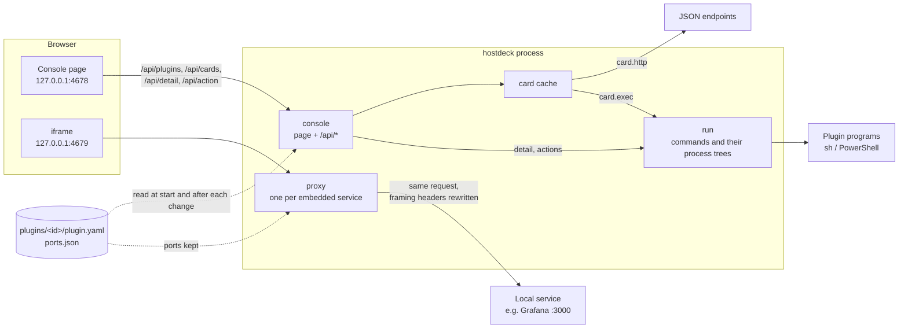

# Architecture

[简体中文](ARCHITECTURE.zh-CN.md)

hostdeck is one Go program. It serves a web console on 127.0.0.1, reads plugins from a folder when it starts and after each change on its plugins page, and re-serves each embedded web UI on a port of its own. There is no database and no background worker: everything happens when the console page asks.

## The pieces

Startup, in `main.go`:

1. Pick the folder: `--dir`, else `HOSTDECK_DIR`, else `~/.config/hostdeck` on macOS or `%LOCALAPPDATA%\hostdeck` on Windows.
2. Load every `plugins/<id>/plugin.yaml`. A plugin that does not load is set aside with its error and shown later as an error card; the others load. The card uses the name written in the manifest when that name can be read. A variable that is not set is named on its own, and the file path is kept apart from the sentence.
3. Listen on `--addr` (127.0.0.1 only, 4678 by default).
4. Give each plugin with `page.proxy` a forwarding port, from the console's port + 1 up, remembered in `ports.json` so that it never moves and the browser keeps that service's cookies and storage.
5. Serve.

After the plugins page adds, disables or enables a plugin, the same request reads the plugins folder again, steps 2 and 4 included: a service that is no longer there, or whose `page.proxy` changed, stops serving its port, and a new one gets a port as above, or its own back. Cards are then asked anew. If reading fails, what was in use stays and the page says so. A folder changed by hand is read at the next start or the next change on the plugins page.

## Packages

| Package | What it does |
| --- | --- |
| `main` | Flags, the folder, startup, and one proxy per embedded service, started and stopped as the plugins change. |
| `internal/plugin` | Reads and checks `plugin.yaml`: unknown fields are errors with their line. Holds the types every other package uses: `Text` (one string, or one per language), `Scalar`, thresholds, `${env:NAME}` expansion. |
| `internal/card` | Turns a plugin's card into what the overview shows. `http` cards: GET, pick values with gjson paths, colour them with thresholds, hide secrets in errors. `exec` cards: run the program and read the card it prints. `Cache` keeps each card for its interval and answers "pending" when a card takes longer than the overview waits. |
| `internal/detail` | Runs a plugin's detail program and its actions. Before an action runs, the detail is read again, and the action must still be offered for that item. |
| `internal/run` | Runs a plugin program in its folder with a deadline, caps its output, and kills everything it started: a process group on macOS, a Job Object on Windows. Decodes the JSON it prints strictly. |
| `internal/console` | The console's HTTP handler: the page from `web/`, the API, and the checks every request passes. |
| `internal/proxy` | Re-serves one local web UI on its own port, so that the console may frame it. Answers the clear-cache address itself. |
| `internal/ports` | Gives each embedded service its forwarding port and remembers it in `ports.json`. |
| `internal/layout` | Remembers in `layout.json` the order of the sidebar and of the cards, and which cards are wide. |
| `internal/atomicfile` | Writes `layout.json` and `ports.json` whole or not at all: a temporary file renamed over the old one. On Windows, a rename refused because another program has the file open is tried again for up to 2 s. |
| `internal/local` | Lets through only requests addressed to `127.0.0.1`; `localhost` is redirected there. |
| `internal/onetime` | One-time tokens for clearing a service's cache. |
| `internal/catalog` | For the plugins page: lists the plugins built into hostdeck and copies one into the plugins folder; lists the installed plugins and disables or enables one by renaming its folder. |
| `examples` | The built-in plugins: disk, Grafana, Syncthing and Ollama, embedded in the program. |
| `web` | The console page: `index.html`, `app.js` (plain ES modules, no build step), `style.css`, and `i18n/*.json`. Embedded in the program. |

## Plugins

A plugin is a folder; its folder name is its ID. A folder whose name starts with a dot is skipped: that is how a plugin is disabled. `plugin.yaml` declares any of:

- **`page`**: a sidebar entry. `proxy` embeds a local web UI through its own forwarding port; `link` opens a URL in a new tab.
- **`card`**: a card on the overview, either declarative or a program.
  - `http`: a URL and headers (`${env:NAME}` allowed), a `value` and `rows` given as gjson paths, a `label`, and `warn` / `error` thresholds (`above`, `below`, `equals` or `not`). `interval` says how long a reading is kept (1 minute by default).
  - `exec`: a command, with a `windows` variant, that prints the card as JSON:
    `{"status": "ok|warn|error", "value": …, "label": …, "rows": [{"name": …, "value": …, "status": …}]}`, or `{"error": …}`.
- **`detail`**: a sidebar entry whose page lists items. Its program prints `{"items": [{"id", "name", "status", "value", "fields": [{"name", "value"}], "log", "actions": [{"id", "label"}]}]}`.
- **`actions`**: the program run for an action on an item, as `<command> <action id> <item id>`. It may print `{"message": …}` or `{"error": …}`.

`description` says what the plugin does and what to change before using it; the plugins page shows it.

Text shown to people is a string, or `{en: …, zh-CN: …}`. Programs run in the plugin's folder; on Windows, scripts should be UTF-8 with a BOM and write UTF-8.

## What happens when…

**The overview opens.** `GET /api/cards` asks the card cache for every card at once and waits up to 5 s. A card still within its interval is answered from the cache. Otherwise it is read in the background, for up to 30 s; one that is not back in time is returned as `pending`, with its last value if there is one, and the page asks again 2 s later. A failed reading is not kept, so a service that recovers shows at once.

**An embedded page opens.** The page puts an iframe on `http://127.0.0.1:<forwarding port>/`. The proxy passes each request on with its Host unchanged (some services check that Origin and Host agree) and rewrites only the framing headers of the answer: `X-Frame-Options` is removed, and `frame-ancestors` becomes `'self'` plus the console. The rest of the service's Content-Security-Policy is kept. Each service has its own origin, so services do not share storage. `page.proxy` is meant for services on this machine: the service sees the browser's Host, `127.0.0.1:<forwarding port>`, so one that is told apart from others on a shared server by its name would not be found, and the browser keeps every embedded service's cookies under `127.0.0.1`.

**Clear cache.** The first click arms the button; the second runs it. The page asks `POST /api/clear/<id>` for a one-time token, unloads the service's frame, opens `/.well-known/hostdeck/clear-site-data?token=…` on the service's port in a hidden frame, and goes back. The proxy answers that address itself with `Clear-Site-Data: "cache", "storage"` and a page that tells the console, by `postMessage`, that it cleared; a refused token also loads a page, so without that message the console reports a failure. Cookies are kept, because browsers keep cookies per host, not per port.

**A built-in plugin is added.** The plugins page lists the plugins embedded in the program, with whether the plugins folder has one of that name and whether this run loaded it. Adding needs a second click and the console's Origin. Only a top-level folder of the built-in plugins can be named, and a folder that is already there is never replaced. The copy is written under a name that starts with a dot, which loading skips, and then renamed, so a failure leaves nothing half written. The plugin is then in use. Nothing is downloaded.

**A plugin is disabled or enabled.** The plugins page lists every folder in the plugins folder, disabled ones included, with whether this run loaded it. Disabling renames `disk` to `.disk`, and enabling renames it back; nothing inside changes, and neither replaces a folder that is there. Both need a second click and the console's Origin, and take effect at once.

**A web page is embedded.** The plugins page takes an address and an optional name, or an address dragged onto the console from the browser, and sends them to `POST /api/pages`, which needs the console's Origin. An address without a scheme gets `http://`. Only http and https are taken, and only a host whose every address is loopback, private or link-local, looked up for at most 3 seconds: the proxy sends the service 127.0.0.1 as its host, which a site on the internet would not answer to. The plugin's folder is named after the host and port, with `-2`, `-3` … when one of that name, enabled or disabled, is there, and holds a `plugin.yaml` with only the name and `page.proxy`, written the same way as an added built-in plugin. It is put to use at once, and the console opens it.

**The sidebar or the cards are rearranged.** A sidebar entry or a card is dragged to its place, and a card's button, shown under the pointer, makes it two columns wide or one again; the sidebar and the cards each keep their own order. The page sends `POST /api/layout` with the list that changed, from the console's Origin, and the other lists stay as they were. `/api/plugins` and `/api/cards` answer in the saved order; plugins not in it follow in folder order. While something is dragged the page is not redrawn, and the cards are rebuilt only when they are read, rearranged or the language changes, so that a periodic redraw does not drop a drag or a click.

**An action runs.** The first click arms the button, and a double click counts as one click. `POST /api/action/<id>` must come from the console's own Origin. The detail program is run again, and the action runs only if it is still offered for that item. Once started, the action runs to its end or its 30 s limit even if the page is closed or reloaded, so that a restart is not stopped halfway.

## Security model

Everything rests on hostdeck being reachable from this machine only.

- It listens on `127.0.0.1` only; any other `--addr` is refused.
- Every server answers only requests whose Host is `127.0.0.1`. This stops a web page that rebinds its own domain to 127.0.0.1 from reading the console or a service through hostdeck.
- `/api/` refuses requests from other sites by their `Sec-Fetch-Site` header; a request typed into the address bar may only read. Actions also require the console's Origin. Other ports on 127.0.0.1 count as the same site, which is why the Origin check is needed too.
- The console cannot be framed (`frame-ancestors 'none'`), and it frames only `http://127.0.0.1:*`. An embedded service may be framed only by itself and the console.
- Clearing a service's data needs a token from the console, so another local page cannot wipe it with a link.
- Adding a plugin from the plugins page needs the console's Origin and can only copy a plugin built into the program, so the worst a page could do through it is add one of those. Embedding a web page needs the console's Origin too, and writes only a manifest with a name and a `page.proxy` to a host on this machine or the local network: no command to run. Disabling and enabling need the console's Origin too, and only rename a folder inside the plugins folder. Saving the layout needs it as well, and writes only `layout.json`.
- `${env:NAME}` values are sent to the service but replaced by `***` in errors, also when quoted or URL-escaped. A token is never written into `plugin.yaml`.
- A plugin program cannot outlive its deadline: its whole process tree is ended.

Plugins themselves are trusted: they are folders you put there, and they run with your rights.

## Platforms

Platform code is kept apart by build tags: the default folder (`dir_unix.go`, `dir_windows.go`) how process trees end (`internal/run/tree_unix.go`, `tree_windows.go`), and how a file is replaced (`internal/atomicfile/replace_unix.go`, `replace_windows.go`). Windows PowerShell 5.1 can take many seconds to start the first time. This is why cards may come back pending, and why detail programs get 30 s.

## Tests and CI

- Each package has unit tests that use local HTTP servers and the test binary as a fake plugin program.
- `e2e/` builds the program and drives Chrome or Edge through chromedp: languages, embedding a service that refuses frames, clearing its cache, cards, actions, dragging sidebar entries and cards and widening a card, adding, disabling and enabling plugins on the plugins page, and embedding a web page by its address or by dropping it. Without a browser these tests are skipped, unless `HOSTDECK_E2E=1`.
- `examples/` tests run the disk example on the machine at hand, and again on a macOS `df` output copied from a Mac with two disks and Time Machine backups mounted; they answer the Grafana, Syncthing and Ollama examples with responses copied from their documentation.
- CI runs gofmt, vet and all tests on macOS and Windows, then the browser tests again in Edge. Another job builds the release archives with GoReleaser as a snapshot and checks that each holds the program and the examples. Nothing is published.

## Not there yet

Background checks and notifications (M2), launchd, Windows services, Docker and port views (M1), a desktop window (M3), and Starlark plugins with declared permissions (M4). See the roadmap in the README.
