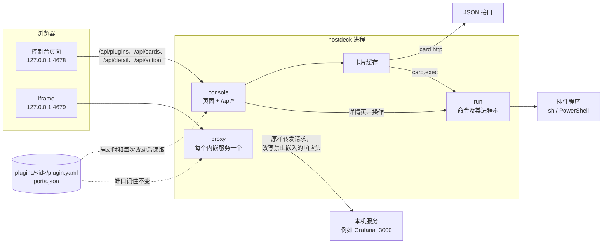

# 架构

[English](ARCHITECTURE.md)

hostdeck 是一个 Go 程序。它在 127.0.0.1 上提供网页控制台，启动时和插件页每次改动后从一个文件夹读取插件，并给每个内嵌的网页界面另开一个端口重新提供。没有数据库，也没有后台任务：所有事情都在控制台页面发起请求时才发生。

## 组成

启动过程（`main.go`）：

1. 确定文件夹：`--dir`，否则 `HOSTDECK_DIR`，否则 macOS 上的 `~/.config/hostdeck` 或 Windows 上的 `%LOCALAPPDATA%\hostdeck`。
2. 读取每个 `plugins/<id>/plugin.yaml`。读不进来的插件连同错误原因单独放着，之后显示成错误卡片；其他插件照常加载。卡片能读到清单里的名称时就用那个名称。没设置的变量单独写明是哪一个，文件路径不写进那句话里。
3. 监听 `--addr`（只能是 127.0.0.1，默认 4678）。
4. 给每个带 `page.proxy` 的插件分一个转发端口，从控制台端口 + 1 往上找，记在 `ports.json` 里。端口从此不变，浏览器为这个服务保存的 cookie 和存储也就一直有效。
5. 开始服务。

插件页添加、停用或启用插件后，同一个请求会重新读取插件文件夹，第 2 步和第 4 步都会重做：已经不在的服务，或者 `page.proxy` 改了的服务，会停止在它的端口上提供；新的服务按上面的办法分到端口，原来有端口的拿回原来那个。之后卡片重新获取。读取失败时，原来在用的插件保持不变，页面会说明原因。手动改动的文件夹在下次启动或插件页下一次改动时读取。

## 各个包

| 包 | 做什么 |
| --- | --- |
| `main` | 命令行参数、文件夹、启动，以及给每个内嵌服务开一个代理，插件变化时随之启停。 |
| `internal/plugin` | 读取并检查 `plugin.yaml`：未知字段报错并给出行号。也定义其他包共用的类型：`Text`（一个字符串，或每种语言一个）、`Scalar`、阈值，以及 `${env:NAME}` 的展开。 |
| `internal/card` | 把插件的卡片变成总览上显示的样子。`http` 卡片：发 GET 请求，用 gjson 路径取值，按阈值上色，报错里隐去令牌。`exec` 卡片：运行程序，读取它打印的卡片。`Cache` 按间隔保留每张卡片；超过总览等待时间还没读完的，先返回「读取中」。 |
| `internal/detail` | 运行插件的详情程序和操作。执行操作前会重新读一次详情，这个操作仍然出现在那个条目上才执行。 |
| `internal/run` | 在插件文件夹里带时限运行插件程序，限制输出大小，结束时连同它启动的所有进程一起结束：macOS 上用进程组，Windows 上用 Job Object。严格解析程序打印的 JSON。 |
| `internal/console` | 控制台的 HTTP 处理：`web/` 里的页面、API，以及每个请求都要过的检查。 |
| `internal/proxy` | 在单独的端口上重新提供一个本机网页界面，让控制台可以把它嵌进来。清除缓存的地址由它自己应答。 |
| `internal/ports` | 给每个内嵌服务分配转发端口，并记在 `ports.json` 里。 |
| `internal/layout` | 把侧栏和卡片的顺序、哪些卡片加宽、哪些插件隐藏，记在 `layout.json` 里。 |
| `internal/atomicfile` | 写 `layout.json` 和 `ports.json` 时要么整份写成，要么不动：先写临时文件，再改名覆盖旧文件。Windows 上别的程序开着这个文件时改名会被拒绝，这时最多重试 2 秒。 |
| `internal/local` | 只放行发往 `127.0.0.1` 的请求；发往 `localhost` 的重定向过去。 |
| `internal/onetime` | 清除服务缓存用的一次性令牌。 |
| `internal/catalog` | 供插件页使用：列出 hostdeck 自带的插件，并把其中一个复制到插件文件夹；列出已安装的插件，并通过给文件夹改名来停用或启用。 |
| `examples` | 自带的插件：disk、Grafana、Syncthing 和 Ollama，编进程序里。 |
| `web` | 控制台页面：`index.html`、`app.js`（原生 ES 模块，不需要构建）、`style.css` 和 `i18n/*.json`。编进程序里。 |

## 插件

一个插件就是一个文件夹，文件夹名就是它的 ID。以点开头的文件夹会被跳过，停用插件就是靠这一点。`plugin.yaml` 里可以声明以下几项：

- **`page`**：侧栏的一项。`proxy` 通过单独的转发端口内嵌一个本机网页界面；`link` 在新标签页里打开一个地址。
- **`card`**：总览上的一张卡片，声明式的或者由程序生成。
  - `http`：一个地址和若干请求头（可以写 `${env:NAME}`），用 gjson 路径写出的 `value` 和 `rows`，一个 `label`，以及 `warn` / `error` 阈值（`above`、`below`、`equals`、`not` 四选一）。`interval` 表示一次读数保留多久，默认 1 分钟。
  - `exec`：一条命令（可以另写 `windows` 版本），把卡片按 JSON 打印出来：
    `{"status": "ok|warn|error", "value": …, "label": …, "rows": [{"name": …, "value": …, "status": …}]}`，或者 `{"error": …}`。
- **`detail`**：侧栏的一项，它的页面列出若干条目。它的程序打印 `{"items": [{"id", "name", "status", "value", "fields": [{"name", "value"}], "log", "actions": [{"id", "label"}]}]}`。
- **`actions`**：对条目执行操作时运行的程序，调用方式是 `<命令> <操作 id> <条目 id>`。它可以打印 `{"message": …}` 或 `{"error": …}`。

`description` 说明插件做什么、用之前要改什么，插件页会显示它。

给人看的文字可以是一个字符串，也可以是 `{en: …, zh-CN: …}`。程序在插件自己的文件夹里运行；Windows 上的脚本应当存成带 BOM 的 UTF-8，并输出 UTF-8。

## 各个操作的经过

**打开总览。** `GET /api/cards` 同时向卡片缓存要所有卡片，最多等 5 秒。还在间隔内的卡片直接从缓存返回；其余的在后台读取，最多 30 秒。没按时读完的标成 `pending` 返回，有旧值就带上旧值，页面 2 秒后再取一次。读取失败的结果不缓存，服务恢复后马上就能看到。

**打开内嵌页面。** 页面放一个 iframe，地址是 `http://127.0.0.1:<转发端口>/`。代理转发每个请求时保持 Host 不变（有些服务会检查 Origin 和 Host 是否一致），只改写响应里和嵌入有关的头：去掉 `X-Frame-Options`，`frame-ancestors` 改成 `'self'` 加控制台。服务的 Content-Security-Policy 其余部分保持不变。每个服务各有自己的源，存储互不相通。`page.proxy` 是给本机服务用的：服务看到的 Host 是浏览器发来的 `127.0.0.1:<转发端口>`，同一台服务器上靠域名区分的多个站点因此找不到对应的那个；而且浏览器会把所有内嵌服务的 cookie 都存在 `127.0.0.1` 名下。

**清除缓存。** 第一次点击只是让按钮进入待确认状态，第二次才执行。页面先通过 `POST /api/clear/<id>` 拿一个一次性令牌，把服务的 iframe 卸载掉，再用一个隐藏的 iframe 打开服务端口上的 `/.well-known/hostdeck/clear-site-data?token=…`，然后返回原页面。这个地址由代理自己应答，带上 `Clear-Site-Data: "cache", "storage"`，返回的页面再用 `postMessage` 告诉控制台已经清除。令牌被拒绝时也会载入一个页面，所以收不到这条消息，控制台就报告清除失败。cookie 不清：浏览器按主机名保存 cookie，不区分端口。

**添加自带插件。** 插件页列出编进程序里的插件，并标出插件文件夹里是否已有同名文件夹、这次运行是否已加载它。添加要点两次，并且要来自控制台的 Origin。只能指定自带插件的顶层文件夹，已经存在的同名文件夹绝不覆盖。复制时先写到一个以点开头的文件夹（加载时会跳过），再一次性改名，所以中途失败不会留下写了一半的插件。添加后插件立即可用。不会下载任何东西。

**停用和启用插件。** 插件页列出插件文件夹里的所有插件，包括已停用的，并标出这次运行是否已加载。停用就是把 `disk` 改名为 `.disk`，启用再改回来；里面的内容不变，也绝不覆盖已经存在的文件夹。两者都要点两次，并且要来自控制台的 Origin，立即生效。结果写在被改动的那张插件卡片上。

**插件页的排列。** 已安装的插件分成使用中、已停用和有问题。每一组，以及自带插件，都按当前语言的名称排序。同一行的卡片保持各自的高度。这一页列出的插件超过八个时，出现搜索框，按这个名称缩小范围。内嵌网页和自带插件是同一块，放在已经安装的插件后面。

**内嵌网页。** 插件页接收一个网址和可选的名称，或者从浏览器拖到控制台上的网址，发给 `POST /api/pages`，这个请求要来自控制台的 Origin。没写协议的网址补上 `http://`。只接受 http 和 https，而且主机解析出的每个地址都必须是本机回环、私有或链路本地地址，解析最多等 3 秒：代理发给服务的 Host 是 127.0.0.1，公网网站不会认。插件文件夹按主机和端口命名，已有同名文件夹（启用或停用的都算）时依次加 `-2`、`-3`……，里面只有一个写着名称和 `page.proxy` 的 `plugin.yaml`，写入方式和添加自带插件一样。添加后立即生效，控制台直接打开它。

**添加链接。** 同一个表单也可以添加链接，而不是内嵌。它带着控制台的 Origin 发 `POST /api/pages`，正文里 `"mode"` 是 `"link"`，用的是同一把锁，一次只处理一个。没写协议的网址补上 `http://`。只接受 http 和 https，主机不要求在本机。清单里只有名称和 `page.link`，写入方式一样，没有命令。不写 mode，或者把网址拖到控制台上，仍然是内嵌，仍然要求本机或局域网。控制台不在自己里面打开链接；侧栏条目在新标签打开它。

**再读一遍总览。** 卡片写明这次的值是什么时候读到的。`POST /api/cards/refresh` 需要控制台的 Origin，不写任何文件，只忘掉记下的值，于是下一次读取会再问每一张卡片。总览一直开着时，失败的卡片会再问一次。成功的卡片在它的间隔之内保持不变。

**卡片打开它的插件。** 总览上的卡片，如果它的插件在侧栏里，就打开那个条目。代理页面和详情页在控制台里打开，链接在新标签打开。加宽按钮不会打开。没有侧栏条目的卡片无处可开。插件页写明每个清单声明了侧栏页面、卡片、详情、操作中的哪些，停用的也写，并且这次运行已经放进侧栏的插件可以打开。

**排列侧栏和卡片。** 侧栏条目和卡片都可以拖到想要的位置，也可以用「上移」「下移」挪一格。侧栏的这两个按钮在链接外面的更多操作面板中，键盘能走到；关闭时不进入 Tab 顺序。总览使用同样的更多操作面板。第一条不能上移，最后一条不能下移。卡片的操作面板也可以把它加宽到两列或者恢复成一列。这些改动都立刻保存，页面给出一次撤销。侧栏和卡片各排各的。页面带着控制台的 Origin 发 `POST /api/layout`，只带改动的那一项，其余各项保持不变。`/api/plugins` 和 `/api/cards` 按存下的顺序返回，没排过的插件按文件夹顺序跟在后面。拖动期间页面不重绘；卡片只在读取、重新排列或切换语言时重建，免得定时重绘打断拖动或吞掉点击。

**隐藏插件，或重置布局。** 「隐藏」和「上移」「下移」放在一起，在链接外面，显示的时机也一样。侧栏里这几个按钮放在更多操作面板中，点名称仍然会打开。卡片上的这些按钮也放在操作面板里，不再为悬停控件预留空白。点一下就保存。插件仍安装着，只是离开侧栏和总览；它在顺序里的位置、卡片是否加宽，都留在 `layout.json` 里。插件页上有「显示」，点了就回到原来的位置。总览上「刷新」旁边的「重置」清掉顺序、加宽和隐藏。页面同样给出一次撤销，和挪动之后一样。页面先读 `GET /api/layout`，再带着控制台的 Origin 发 `POST /api/layout`。请求里没写的项保持不变。重置是这个请求上的一个标记，不会写进文件。页面保存仍然显示着的新顺序时，隐藏的 ID 留在原来的位置。页面不写命令。

**修改页面的名称、图标或地址。** 插件页上，已安装的插件有「修改」，保存一次即可。页面带着控制台的 Origin 发 `POST /api/plugins/{id}/page`，和添加页面用同一把锁，一次只处理一个，然后重新加载插件。请求里没写的字段保持原样。清单按 YAML 节点写回，注释和其他键都留着，包括命令；页面不写命令。内嵌地址和链接不能同时设置：设了其中一个就去掉另一个，两个都发来则拒绝。内嵌地址必须是 http 或 https，并且在本机或局域网，会再解析一次。链接必须是 http 或 https，不要求在本机。卡片地址只改已经存在的 `card.http.url`；命令卡片不动，也不会新建卡片。转发端口仍属于这个插件的 id。文件夹不改名。保存被拒绝时，填写的内容留在这张卡片的表单上。保存成功时，这张卡片上记一笔。

**把插件移入回收区。** 插件页上，点一下就把已安装的插件移入回收区，再点一下放回。清除要点第二次；双击不算确认。页面带着控制台的 Origin 发 `POST /api/plugins/{id}/trash`、`POST /api/trash/{folder}/restore` 和 `POST /api/trash/{folder}/purge`，用的是同一把锁，一次只处理一个，然后重新加载插件。移入是把插件文件夹，或者已停用的那个文件夹，改名到 `plugins/.trash/<id>-<时间>`。这个目录以点开头，所以读取时会跳过，插件离开侧栏。放回时文件夹回到 `plugins/<id>`，并且是启用的，即使移入之前是停用的；这个名字已经有文件夹时，回收区里的那份留在原地。清除只删 `.trash` 里的这一个文件夹。转发端口仍属于这个插件的 id。不写命令。

**执行操作。** 第一次点击进入待确认状态，双击只算一次点击。`POST /api/action/<id>` 必须来自控制台自己的 Origin。详情程序会重新运行一次，这个操作仍然出现在那个条目上才执行。操作一旦开始，即使页面被关掉或刷新，也会一直运行到结束或 30 秒时限，免得重启之类的操作停在半途。

## 安全模型

一切都建立在「只有这台机器能访问 hostdeck」这一点上。

- 只监听 `127.0.0.1`；其他 `--addr` 一律拒绝。
- 每个服务端都只应答 Host 为 `127.0.0.1` 的请求。这样，一个把自己域名重新解析到 127.0.0.1 的网页，就没法借 hostdeck 读到控制台或任何服务。
- `/api/` 根据 `Sec-Fetch-Site` 请求头拒绝其他站点发来的请求；在地址栏里直接输入的请求只能读取。操作还要求 Origin 是控制台。127.0.0.1 上的其他端口在浏览器看来属于同一站点，所以 Origin 检查也是必需的。
- 控制台本身不能被嵌入（`frame-ancestors 'none'`），它也只嵌入 `http://127.0.0.1:*`。内嵌的服务只允许被它自己和控制台嵌入。
- 清除服务数据需要控制台给的令牌，其他本机网页没法用一个链接就把它清掉。
- 从插件页添加插件需要控制台的 Origin，而且只能复制编进程序里的插件，所以任何页面借这条路最多也只能添加其中一个。内嵌网页同样需要控制台的 Origin，而且只会写一份只有名称和 `page.proxy` 的清单，地址必须在本机或局域网，不含任何要运行的命令。添加链接同样需要控制台的 Origin，而且只会写一份只有名称和 `page.link` 的清单。地址必须是 http 或 https，不要求在本机，不含任何要运行的命令。停用和启用同样需要控制台的 Origin，而且只会给插件文件夹里的文件夹改名。保存布局也需要它，而且只会写 `layout.json`：顺序、哪些卡片加宽、哪些插件被隐藏，以及一次清空这份文件的重置。刷新卡片也需要控制台的 Origin，而且不写任何文件，只忘掉记在内存里的值。修改页面的名称、图标或地址同样需要控制台的 Origin，而且只会改这份插件清单里允许的字段：名称、图标、`page.proxy` 或 `page.link`（不能同时改成两个），以及已经存在的 `card.http.url`。不写命令，不写 `ports.json`，也不给文件夹改名。内嵌地址会再检查一次是不是本机或局域网。把插件移入回收区、放回和清除同样需要控制台的 Origin。移入是把这个插件的文件夹（启用或停用的）改名进 `.trash`。放回时改回启用的文件夹，名字已被占用就留在回收区。清除只删除 `.trash` 的一个直接子目录。三者都不写命令，也不写 `ports.json`。
- `${env:NAME}` 的值会发给服务，但在报错里替换成 `***`，加引号或经过 URL 转义的形式也会替换。令牌从不写进 `plugin.yaml`。
- 插件程序不能超过时限运行：到时会结束它整个进程树。

插件本身是被信任的：它们是你自己放进去的文件夹，以你的权限运行。

## 平台

平台相关的代码用 build tag 分开：默认文件夹（`dir_unix.go`、`dir_windows.go`），结束进程树的方式（`internal/run/tree_unix.go`、`tree_windows.go`），以及替换文件的方式（`internal/atomicfile/replace_unix.go`、`replace_windows.go`）。Windows PowerShell 5.1 第一次启动可能要好几秒，所以卡片可能先显示「读取中」，详情程序的时限也定为 30 秒。

## 测试和 CI

- 每个包都有单元测试，用本机 HTTP 服务和测试程序本身充当假的插件程序。
- `e2e/` 编译出程序，通过 chromedp 驱动 Chrome 或 Edge：语言、内嵌一个禁止嵌入的服务、清除它的缓存、卡片、从卡片打开插件以及插件页写明插件提供什么、操作、拖动侧栏条目和卡片、上移下移并撤销、隐藏插件再显示、重置布局并撤销、加宽卡片，在插件页添加、停用和启用插件、修改页面的名称、图标或地址、添加链接、把插件移入回收区并在那里清除，以及按网址或拖入内嵌网页。没有浏览器时跳过这些测试，除非设置了 `HOSTDECK_E2E=1`。
- `examples/` 的测试在当前机器上运行 disk 示例，再用从一台有两块盘、挂着 Time Machine 备份的 Mac 上抄来的 `df` 输出跑一遍；Grafana、Syncthing、Ollama 三个示例则用从官方文档抄来的返回来测。
- CI 在 macOS 和 Windows 上跑 gofmt、vet 和全部测试，然后在 Edge 里再跑一遍浏览器测试。另一个任务用 GoReleaser 打快照发布包，检查每个包里都有程序和示例。不会发布任何东西。

## 还没有的

后台检查和通知（M2），launchd、Windows 服务、Docker 和端口视图（M1），桌面窗口（M3），以及声明权限的 Starlark 插件（M4）。见 README 里的路线图。

桌面侧栏宽 240px，插件列表独立滚动。侧栏每项始终显示更多操作入口，上移、下移和隐藏在操作面板中，关闭时不进入 Tab 顺序；Escape 关闭面板并把焦点还给入口。640px 以下由顶栏打开导航抽屉，关闭时抽屉不可聚焦，打开时正文不可交互，键盘焦点限制在侧栏内；Escape 或遮罩关闭后把焦点还给菜单按钮。恢复桌面宽度时解除不可交互状态。总览使用同样的更多操作面板。

总览卡片把读取时间放在数值和明细之后。卡片控件持有焦点时，新读数等待焦点离开后显示，轮询不会移除打开的面板；布局改动丢弃等待中的读数。布局保存失败后读取服务端最后保存的布局，先恢复可见条目再报告错误。空总览提供直达插件管理的入口，刷新期间禁用刷新按钮。

插件管理直接提供打开、显示和行内修改；启用、停用、移入回收区放在插件的更多操作面板中，清除放在回收条目的面板中。第一次确认点击保留面板展开。页头快捷入口聚焦已安装插件之后的添加表单；字段有可见标签，提示随内嵌或链接方式切换。失败保留输入，结果在对应表单或插件旁播报。

服务工具栏直接提供刷新和新标签打开，清除缓存放在更多操作中。第一次点击保留面板并显示原有清除说明；第二次关闭面板，在外部报告进度。关闭面板或切换控制台语言不重建内嵌页面。状态点有文字标签，相同错误不会被重复播报。
