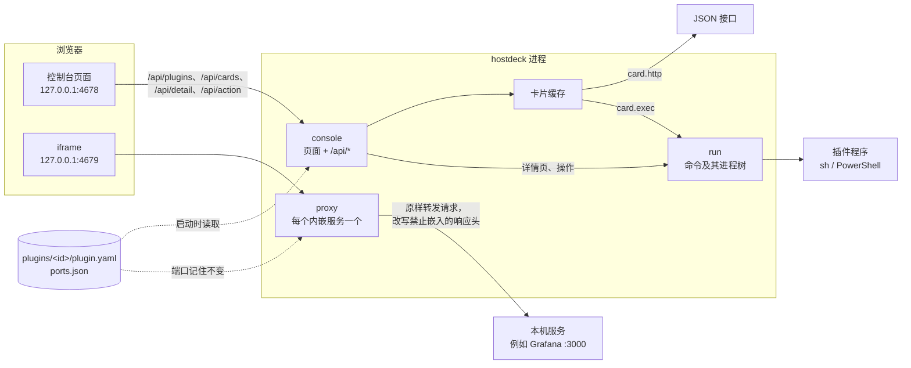

# 架构

[English](ARCHITECTURE.md)

hostdeck 是一个 Go 程序。它在 127.0.0.1 上提供网页控制台，启动时从一个文件夹读取插件，并给每个内嵌的网页界面另开一个端口重新提供。没有数据库，也没有后台任务：所有事情都在控制台页面发起请求时才发生。

## 组成

启动过程（`main.go`）：

1. 确定文件夹：`--dir`，否则 `HOSTDECK_DIR`，否则 macOS 上的 `~/.config/hostdeck` 或 Windows 上的 `%LOCALAPPDATA%\hostdeck`。
2. 读取每个 `plugins/<id>/plugin.yaml`。读不进来的插件连同错误原因单独放着，之后显示成错误卡片；其他插件照常加载。
3. 监听 `--addr`（只能是 127.0.0.1，默认 4678）。
4. 给每个带 `page.proxy` 的插件分一个转发端口，从控制台端口 + 1 往上找，记在 `ports.json` 里。端口从此不变，浏览器为这个服务保存的 cookie 和存储也就一直有效。
5. 先在程序旁边、再在工作目录里找 `examples` 文件夹，总览为空时用来推荐示例。
6. 开始服务。

插件只在启动时读取：增加或修改插件后要重启 hostdeck。

## 各个包

| 包 | 做什么 |
| --- | --- |
| `main` | 命令行参数、文件夹、启动，以及给每个内嵌服务开一个代理。 |
| `internal/plugin` | 读取并检查 `plugin.yaml`：未知字段报错并给出行号。也定义其他包共用的类型：`Text`（一个字符串，或每种语言一个）、`Scalar`、阈值，以及 `${env:NAME}` 的展开。 |
| `internal/card` | 把插件的卡片变成总览上显示的样子。`http` 卡片：发 GET 请求，用 gjson 路径取值，按阈值上色，报错里隐去令牌。`exec` 卡片：运行程序，读取它打印的卡片。`Cache` 按间隔保留每张卡片；超过总览等待时间还没读完的，先返回「读取中」。 |
| `internal/detail` | 运行插件的详情程序和操作。执行操作前会重新读一次详情，这个操作仍然出现在那个条目上才执行。 |
| `internal/run` | 在插件文件夹里带时限运行插件程序，限制输出大小，结束时连同它启动的所有进程一起结束：macOS 上用进程组，Windows 上用 Job Object。严格解析程序打印的 JSON。 |
| `internal/console` | 控制台的 HTTP 处理：`web/` 里的页面、API，以及每个请求都要过的检查。 |
| `internal/proxy` | 在单独的端口上重新提供一个本机网页界面，让控制台可以把它嵌进来。清除缓存的地址由它自己应答。 |
| `internal/ports` | 给每个内嵌服务分配转发端口，并记在 `ports.json` 里。 |
| `internal/local` | 只放行发往 `127.0.0.1` 的请求；发往 `localhost` 的重定向过去。 |
| `internal/onetime` | 清除服务缓存用的一次性令牌。 |
| `web` | 控制台页面：`index.html`、`app.js`（原生 ES 模块，不需要构建）、`style.css` 和 `i18n/*.json`。编进程序里。 |

## 插件

一个插件就是一个文件夹，文件夹名就是它的 ID。`plugin.yaml` 里可以声明以下几项：

- **`page`**：侧栏的一项。`proxy` 通过单独的转发端口内嵌一个本机网页界面；`link` 在新标签页里打开一个地址。
- **`card`**：总览上的一张卡片，声明式的或者由程序生成。
  - `http`：一个地址和若干请求头（可以写 `${env:NAME}`），用 gjson 路径写出的 `value` 和 `rows`，一个 `label`，以及 `warn` / `error` 阈值（`above`、`below`、`equals`、`not` 四选一）。`interval` 表示一次读数保留多久，默认 1 分钟。
  - `exec`：一条命令（可以另写 `windows` 版本），把卡片按 JSON 打印出来：
    `{"status": "ok|warn|error", "value": …, "label": …, "rows": [{"name": …, "value": …, "status": …}]}`，或者 `{"error": …}`。
- **`detail`**：侧栏的一项，它的页面列出若干条目。它的程序打印 `{"items": [{"id", "name", "status", "value", "fields": [{"name", "value"}], "log", "actions": [{"id", "label"}]}]}`。
- **`actions`**：对条目执行操作时运行的程序，调用方式是 `<命令> <操作 id> <条目 id>`。它可以打印 `{"message": …}` 或 `{"error": …}`。

给人看的文字可以是一个字符串，也可以是 `{en: …, zh-CN: …}`。程序在插件自己的文件夹里运行；Windows 上的脚本应当存成带 BOM 的 UTF-8，并输出 UTF-8。

## 各个操作的经过

**打开总览。** `GET /api/cards` 同时向卡片缓存要所有卡片，最多等 5 秒。还在间隔内的卡片直接从缓存返回；其余的在后台读取，最多 30 秒。没按时读完的标成 `pending` 返回，有旧值就带上旧值，页面 2 秒后再取一次。读取失败的结果不缓存，服务恢复后马上就能看到。

**打开内嵌页面。** 页面放一个 iframe，地址是 `http://127.0.0.1:<转发端口>/`。代理转发每个请求时保持 Host 不变（有些服务会检查 Origin 和 Host 是否一致），只改写响应里和嵌入有关的头：去掉 `X-Frame-Options`，`frame-ancestors` 改成 `'self'` 加控制台。服务的 Content-Security-Policy 其余部分保持不变。每个服务各有自己的源，存储互不相通。`page.proxy` 是给本机服务用的：服务看到的 Host 是浏览器发来的 `127.0.0.1:<转发端口>`，同一台服务器上靠域名区分的多个站点因此找不到对应的那个；而且浏览器会把所有内嵌服务的 cookie 都存在 `127.0.0.1` 名下。

**清除缓存。** 第一次点击只是让按钮进入待确认状态，第二次才执行。页面先通过 `POST /api/clear/<id>` 拿一个一次性令牌，把服务的 iframe 卸载掉，再用一个隐藏的 iframe 打开服务端口上的 `/.well-known/hostdeck/clear-site-data?token=…`，然后返回原页面。这个地址由代理自己应答，带上 `Clear-Site-Data: "cache", "storage"`，返回的页面再用 `postMessage` 告诉控制台已经清除。令牌被拒绝时也会载入一个页面，所以收不到这条消息，控制台就报告清除失败。cookie 不清：浏览器按主机名保存 cookie，不区分端口。

**执行操作。** 第一次点击进入待确认状态，双击只算一次点击。`POST /api/action/<id>` 必须来自控制台自己的 Origin。详情程序会重新运行一次，这个操作仍然出现在那个条目上才执行。操作一旦开始，即使页面被关掉或刷新，也会一直运行到结束或 30 秒时限，免得重启之类的操作停在半途。

## 安全模型

一切都建立在「只有这台机器能访问 hostdeck」这一点上。

- 只监听 `127.0.0.1`；其他 `--addr` 一律拒绝。
- 每个服务端都只应答 Host 为 `127.0.0.1` 的请求。这样，一个把自己域名重新解析到 127.0.0.1 的网页，就没法借 hostdeck 读到控制台或任何服务。
- `/api/` 根据 `Sec-Fetch-Site` 请求头拒绝其他站点发来的请求；在地址栏里直接输入的请求只能读取。操作还要求 Origin 是控制台。127.0.0.1 上的其他端口在浏览器看来属于同一站点，所以 Origin 检查也是必需的。
- 控制台本身不能被嵌入（`frame-ancestors 'none'`），它也只嵌入 `http://127.0.0.1:*`。内嵌的服务只允许被它自己和控制台嵌入。
- 清除服务数据需要控制台给的令牌，其他本机网页没法用一个链接就把它清掉。
- `${env:NAME}` 的值会发给服务，但在报错里替换成 `***`，加引号或经过 URL 转义的形式也会替换。令牌从不写进 `plugin.yaml`。
- 插件程序不能超过时限运行：到时会结束它整个进程树。

插件本身是被信任的：它们是你自己放进去的文件夹，以你的权限运行。

## 平台

平台相关的代码用 build tag 分开：默认文件夹（`dir_unix.go`、`dir_windows.go`），以及结束进程树的方式（`internal/run/tree_unix.go`、`tree_windows.go`）。Windows PowerShell 5.1 第一次启动可能要好几秒，所以卡片可能先显示「读取中」，详情程序的时限也定为 30 秒。

## 测试和 CI

- 每个包都有单元测试，用本机 HTTP 服务和测试程序本身充当假的插件程序。
- `e2e/` 编译出程序，通过 chromedp 驱动 Chrome 或 Edge：语言、内嵌一个禁止嵌入的服务、清除它的缓存、卡片、操作，以及空总览。没有浏览器时跳过这些测试，除非设置了 `HOSTDECK_E2E=1`。
- `examples/` 的测试在当前机器上运行 disk 示例；Grafana、Syncthing、Ollama 三个示例则用从官方文档抄来的返回来测。
- CI 在 macOS 和 Windows 上跑 gofmt、vet 和全部测试，然后在 Edge 里再跑一遍浏览器测试。另一个任务用 GoReleaser 打快照发布包，检查每个包里都有程序和示例。不会发布任何东西。

## 还没有的

后台检查和通知（M2），launchd、Windows 服务、Docker 和端口视图（M1），桌面窗口（M3），以及声明权限的 Starlark 插件（M4）。见 README 里的路线图。
