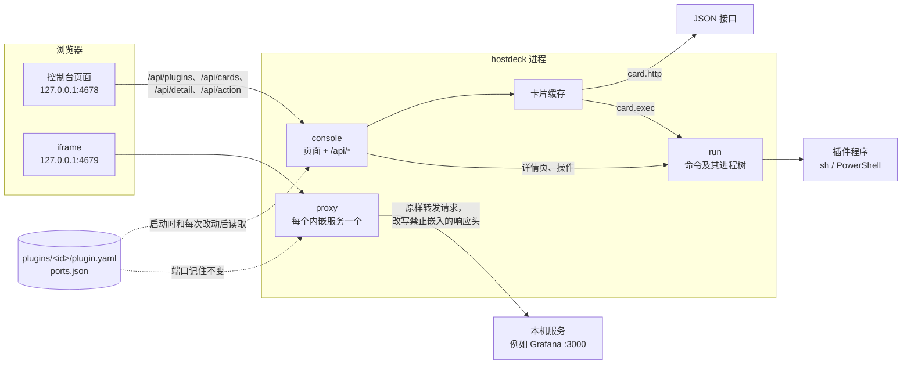

# 架构

[English](ARCHITECTURE.md)

hostdeck 是一个 Go 程序。它在 127.0.0.1 上提供网页控制台，启动时和插件页每次改动后从一个文件夹读取插件，并给每个内嵌的网页界面另开一个端口重新提供。没有数据库服务。除明确开启的磁盘变化每小时扫描，以及 `notifications.json` 关注的卡片按各自间隔在后台读取外，读取都由页面请求触发。

## 组成

启动过程（`main.go`）：

1. 确定文件夹：`--dir`，否则 `HOSTDECK_DIR`，否则 macOS 上的 `~/.config/hostdeck` 或 Windows 上的 `%LOCALAPPDATA%\hostdeck`。
2. 读取每个 `plugins/<id>/plugin.yaml`。读不进来的插件连同错误原因单独放着，之后显示成错误卡片；其他插件照常加载。卡片能读到清单里的名称时就用那个名称。没设置的变量单独写明是哪一个，文件路径不写进那句话里。
3. 监听 `--addr`（只能是 127.0.0.1，默认 4678）。
4. 给每个带 `page.proxy` 的插件分一个转发端口，从控制台端口 + 1 往上找，记在 `ports.json` 里。端口从此不变，浏览器为这个服务保存的 cookie 和存储也就一直有效。
5. 读取 `notifications.json`，开始每秒检查一次它关注的卡片里哪些到了该读的时间。
6. 开始服务。

插件页添加、停用或启用插件后，同一个请求会重新读取插件文件夹，第 2 步和第 4 步都会重做：已经不在的服务，或者 `page.proxy` 改了的服务，会停止在它的端口上提供；新的服务按上面的办法分到端口，原来有端口的拿回原来那个。之后卡片重新获取。读取失败时，原来在用的插件保持不变，页面会说明原因。手动改动的文件夹可以通过 `plugin reload` 读取，也会在下次启动或插件页下一次改动时读取。`notifications.json` 也随之重新读取；那里有错只写进日志，之前加载的推送设置继续生效，不会让这次重新加载失败。

## 各个包

| 包 | 做什么 |
| --- | --- |
| `main` | 命令行参数、文件夹、启动，以及给每个内嵌服务开一个代理，插件变化时随之启停。 |
| `internal/cli` | 输出 JSON 的本机接入命令、HTTP 客户端和经过校验的本机插件复制。 |
| `internal/plugin` | 读取并检查 `plugin.yaml`：未知字段报错并给出行号。也定义其他包共用的类型：`Text`（一个字符串，或每种语言一个）、`Scalar`、阈值，以及 `${env:NAME}` 的展开。 |
| `internal/card` | 把插件的卡片变成总览上显示的样子。`http` 卡片：发 GET 请求，用 gjson 路径取值，按阈值上色，报错里隐去令牌。`exec` 卡片：运行程序，读取它打印的卡片。`Cache` 按间隔保留每张卡片；超过总览等待时间还没读完的，先返回「读取中」。 |
| `internal/detail` | 运行插件的详情程序和操作。执行操作前会重新读一次详情，这个操作仍然出现在那个条目上才执行。 |
| `internal/notify` | 通过总览的卡片缓存读取 `notifications.json` 关注的卡片，连续两次读数看到同一个变化时运行其中的命令。告诉过什么记在 `data/notifications/sent.json`。 |
| `internal/run` | 在插件文件夹里带时限运行插件程序，限制输出大小，结束时连同它启动的所有进程一起结束：Unix 上用进程组（`Setpgid`，再对该组 `kill`），子进程若调用 `setsid` 或以其它方式 daemonize 则可离开该组；Windows 上用 Job Object，会保住整棵进程树。严格解析程序打印的 JSON。 |
| `internal/observation` | 绑定服务会话、验证来源、有界增量、独立采集与保留策略。 |
| `internal/manualview` | 从 shell 启动的 TCP 监听进程：一张卡片和紧凑详情，显示工作目录和命令，并可结束或重启其中一条。 |
| `internal/listenerview` | 本机每一个 TCP 监听端口：端口、绑定地址、PID、进程名、工作目录与命令行，并标记 hostdeck 自身及其转发端口，支持二次确认的结束操作。 |
| `internal/processview` | 只读的可见进程快照，以及可选的 CPU、驻留内存和用户身份。 |
| `internal/console` | 控制台的 HTTP 处理：`web/` 里的页面、API，以及每个请求都要过的检查。 |
| `internal/proxy` | 在单独的端口上重新提供一个本机网页界面，让控制台可以把它嵌进来。清除缓存和通知的地址由它自己应答。 |
| `internal/ports` | 给每个内嵌服务分配转发端口，并记在 `ports.json` 里。 |
| `internal/layout` | 把侧栏和卡片的顺序、哪些卡片加宽、哪些插件隐藏，记在 `layout.json` 里。 |
| `internal/atomicfile` | 写 `layout.json` 和 `ports.json` 时要么整份写成，要么不动：先写临时文件，再改名覆盖旧文件。Windows 上别的程序开着这个文件时改名会被拒绝，这时最多重试 2 秒。 |
| `internal/local` | 只放行发往 `127.0.0.1` 的请求；发往 `localhost` 的重定向过去。 |
| `internal/onetime` | 清除服务缓存用的一次性令牌。 |
| `internal/catalog` | 供插件页使用：列出 hostdeck 自带的插件，并把其中一个复制到插件文件夹；列出已安装的插件，并通过给文件夹改名来停用或启用。 |
| `examples` | 自带的插件，编进程序里，每个一个文件夹：`disk`、`disk-history`、`docker`、`grafana`、`jobs`、`listeners`、`manual`、`ollama`、`processes`、`scheduled-tasks` 和 `syncthing`。 |
| `web` | 控制台页面：`index.html`、无构建步骤的纯 ES 模块、`style.css` 和 `i18n/*.json`。编进程序里。 |

## 页面代码

`web/app.js` 是组合根：它绑定页面自身的控件、填入否则会形成导入环的钩子，并掌管 hash 路由和所有视图共用的那一个 `render()`。其余页面按领域拆分，每个模块只导入层级低于自己的模块：`state`（常量与唯一的可变状态对象）、`dom` 与 `api`（元素构建、JSON 读写）、`i18n`（词典、错误文案、`data-i18n` 一遍刷新）、`panel` 与 `nav`（操作面板、抽屉及其键盘规则）、`layout`（已保存布局与写布局的行内控件）、`plugins` 与 `overview`（侧栏与总览卡片）、`monitor`、`service` 与 `catalog`（三个视图）、`editor`（允许字段编辑对话框）、`dnd`（拖拽）。跨视图共用的小件放在 `frag`、`confirm` 和 `hooks`。模块不导入层级高于自己的模块；少数向上的调用（`render`、`reloadShown`、`loadCatalog`）经过 `hooks.js`，由组合根在 `init()` 时填入。

静态外壳文案经 `data-i18n` 属性一遍刷新；脚本创建的节点在构建时用 `t()` 自行取词。新增键必须在同一改动中加入两份词典。`style.css` 只有一层：先是设计令牌，然后是重置、布局、按页面遇见顺序排列的组件，最后是两个视口断点。每个选择器在每个作用域只写一次，任何规则都不会悄悄覆盖先前的规则，`web/assets_test.go` 负责守住这一点。写在浅底上的文字在两种主题下都不低于 4.5:1：同一个测试从绘制浅底的那条规则里读出配方，按浏览器的方式混色，叠到它所在的表面上再测。所以状态胶囊的浅底只取状态色的 10%，待确认按钮在指针下也有自己更浅的一层红。不靠文字区分控件或状态的东西，和它下面的表面至少差 3:1：输入框的边（平时和指针下）、焦点环、侧栏的状态点。所以输入框的边和还没有消息的状态点用 `--line-control`，比分隔各处的 `--line` 深；`--line` 保持安静。禁用的控件降到一半不透明度，也不响应指针，按不了的按钮不会看起来像能按。标题和 strong 文字在任何地方都是 600，弹窗和接入教程也一样；浏览器默认那种更重的粗体只留给品牌标志。颜色只写在主题的 `:root` 块里，圆角、字重、时长和缓动只用令牌；`web/assets_test.go` 逐项检查。[DESIGN.zh-CN.md](DESIGN.zh-CN.md) 把这些规则连同取值和理由写了出来。视口级布局（抽屉、栅格列数、页面内边距）归媒体查询；组件内部自适应归容器查询。文字只经 `textContent` 写入，插件提供的任何字符串都不会作为 HTML 执行。动效只用三个 `--dur-*` 令牌与一条 `--ease-standard` 曲线（离开时不做动画，所以没有退出曲线），`@media (prefers-reduced-motion: reduce)` 在源头把时长归零，要求减少动效的浏览器会立刻看到同样的结果。入场用 `@starting-style` 淡入。任何被测试测量盒子的元素都不会被 transform，任何出现或消失的元素都不会延迟掌管它的 `hidden` 属性。Go 侧能返回的每个错误码在两份字典里都有一句话，英文的技术细节不会直接走到页面上：`web/i18n_test.go` 从 `internal/` 读出这些错误码并守住这件事。唯一的活动区放在所有视图之外——不在 `main` 里（抽屉会让它 inert），不在侧栏里（焦点环是从侧栏内容算出来的），也不在卡片里（卡片还在读取时每两秒重建一次）。

## 插件

一个插件就是一个文件夹，文件夹名就是它的 ID。以点开头的文件夹会被跳过，停用插件就是靠这一点。`plugin.yaml` 里可以声明 `page`（侧栏的一项：`proxy` 通过单独的转发端口内嵌一个本机网页界面，`link` 在新标签页里打开一个地址）、总览上的 `card`（`http` 直接在清单里声明，`exec` 由程序打印）、由程序列出条目的 `detail` 详情页，以及由程序对这些条目执行的 `actions`。[PLUGINS.zh-CN.md](PLUGINS.zh-CN.md) 是插件的约定：每个字段、程序怎么运行、程序打印什么。清单由 `internal/plugin` 读取，程序的输出由 `internal/card` 和 `internal/detail` 读取，它们的测试会检查 PLUGINS 文档写到了它们接受的每个字段。

## 各个操作的经过

**打开总览。** `GET /api/cards` 同时向卡片缓存要所有卡片，最多等 5 秒。还在间隔内的卡片直接从缓存返回；其余的在后台读取，最多 30 秒。没按时读完的标成 `pending` 返回，有旧值就带上旧值，页面 2 秒后再取一次。读取失败的结果不缓存，服务恢复后马上就能看到。没有卡片的总览、和第一次就没读到的总览，各自在卡片本来在的位置说明自己：这两件事要读者做的不是同一件事；第一次读取还在路上时什么都不说。

**打开内嵌页面。** 页面放一个 iframe，地址是 `http://127.0.0.1:<转发端口>/`。代理每次拨号时都会检查目标主机解析出的地址仍然都是本机回环、私有或链路本地地址，转发每个请求时保持 Host 不变（有些服务会检查 Origin 和 Host 是否一致），只改写响应里和嵌入有关的头：去掉 `X-Frame-Options`，`frame-ancestors` 改成 `'self'` 加控制台。服务的 Content-Security-Policy 其余部分保持不变。每个服务各有自己的源，存储互不相通。`page.proxy` 是给本机服务用的：服务看到的 Host 是浏览器发来的 `127.0.0.1:<转发端口>`，同一台服务器上靠域名区分的多个站点因此找不到对应的那个；而且浏览器会把所有内嵌服务的 cookie 都存在 `127.0.0.1` 名下。

**清除缓存。** 第一次点击只是让按钮进入待确认状态，第二次才执行。页面先通过 `POST /api/clear/<id>` 拿一个一次性令牌，把服务的 iframe 卸载掉，再用一个隐藏的 iframe 打开服务端口上的 `/.well-known/hostdeck/clear-site-data?token=…`，然后返回原页面。这个地址由代理自己应答，带上 `Clear-Site-Data: "cache", "storage"`，返回的页面再用 `postMessage` 告诉控制台已经清除。令牌被拒绝时也会载入一个页面，所以收不到这条消息，控制台就报告清除失败。cookie 不清：浏览器按主机名保存 cookie，不区分端口。

**通知。** 浏览器按顶层页面的源记录通知权限，不同源的 iframe 也不能请求权限：在控制台里，`Notification.requestPermission()` 不弹提示，直接回答 `denied`。被嵌入的服务按控制台的源检查，而它的 service worker 在没有任何页面时显示推送通知，按服务自己的端口检查。服务「更多操作」里的「通知…」打开一个弹窗，每个地址一步。第一步在控制台页面里向浏览器请求，这个权限由所有内嵌页面共用。第二步在服务端口上打开一个小窗口 `/.well-known/hostdeck/notifications`，这个地址由代理自己应答：一个按控制台语言显示的页面，点击后请求权限，用 `postMessage` 把浏览器的回答告诉控制台，然后关闭；之前已经回答过的，打开后立即关闭。没有回答就关掉窗口时，这一步回到之前显示的状态。浏览器阻止了的地址，页面没法再次询问，这时窗口保持打开，说明从地址栏左边的图标打开通知，等浏览器的 `PermissionStatus` 报告变化后自动关闭；弹窗里推送那一步提供「打开 127.0.0.1:<端口>」，在完整的标签页里打开同一个页面。弹窗打开期间，页面那一步跟随控制台自己的 `PermissionStatus` 更新。控制台在本次访问期间记住这个回答，不请求服务端。服务原地址上授予过的权限不会带过来，因为代理端口是另一个源；授权跟着插件在 `ports.json` 里的转发端口走。

**添加自带插件。** 插件页列出编进程序里的插件，并标出插件文件夹里是否已有同名文件夹、这次运行是否已加载它。添加要点两次，并且要来自控制台的 Origin。只能指定自带插件的顶层文件夹，已经存在的同名文件夹绝不覆盖。复制时先写到一个以点开头的文件夹（加载时会跳过），再一次性改名，所以中途失败不会留下写了一半的插件。添加后插件立即可用。不会下载任何东西。

**停用和启用插件。** 插件页列出插件文件夹里的所有插件，包括已停用的，并标出这次运行是否已加载。停用就是把 `disk` 改名为 `.disk`，启用再改回来；里面的内容不变，也绝不覆盖已经存在的文件夹。两者都要点两次，并且要来自控制台的 Origin，立即生效。结果写在被改动的那张插件卡片上。

**页面与插件管理。** 侧栏入口名为「页面与插件」。「已启用」作为第一个主区，后面依次是已停用、需要处理和添加内容，取消多余的「已添加」父标题。各区使用列对齐的统一列表，按当前语言的名称排序；没有启用项时保留标题和空状态。每项分别说明身份、提供功能、接入状态、工作区可见性和操作。说明占两行，长名称截断后可通过提示查看全文。提供功能按清单声明显示网页入口、总览监控、详情查看和执行操作，表示能力而非状态。隐藏只从总览和侧栏移除；启停决定 hostdeck 是否加载这个接入，不会启动或关闭外部服务。重新启用保留原来的隐藏选择。超过九项时显示名称搜索。「添加内容」放在已添加列表之后，包含网页表单和内置插件。内置插件使用横向铺满的列表行，复用已添加条目的名称、功能说明和靠右操作样式，完整显示使用前的配置说明。窄屏自动堆叠，添加按钮及二次确认文案保持可见；实际插件目录收进页尾的折叠说明。

**内嵌网页。** 插件页接收一个网址和可选的名称，或者从浏览器拖到控制台上的网址，发给 `POST /api/pages`，这个请求要来自控制台的 Origin。没写协议的网址补上 `http://`。只接受 http 和 https，而且主机解析出的每个地址都必须是本机回环、私有或链路本地地址，解析最多等 3 秒：代理发给服务的 Host 是 127.0.0.1，公网网站不会认。插件文件夹按主机和端口命名，已有同名文件夹（启用或停用的都算）时依次加 `-2`、`-3`……，里面只有一个写着名称和 `page.proxy` 的 `plugin.yaml`，写入方式和添加自带插件一样。添加后立即生效，控制台直接打开它。品牌链接不会发起浏览器原生的链接拖动。控制台会标记文档内部发起的拖动，忽略这些网址拖放，也忽略与自身同源的网址，避免嵌套自身或复制内部链接。其他本机服务的网址仍可拖入，包括其他端口。这些是浏览器交互保护，API 校验不变。

**添加链接。** 同一个表单也可以添加链接，而不是内嵌。它带着控制台的 Origin 发 `POST /api/pages`，正文里 `"mode"` 是 `"link"`，用的是同一把锁，一次只处理一个。没写协议的网址补上 `http://`。只接受 http 和 https，主机不要求在本机。清单里只有名称和 `page.link`，写入方式一样，没有命令。不写 mode，或者把网址拖到控制台上，仍然是内嵌，仍然要求本机或局域网。控制台不在自己里面打开链接；侧栏条目在新标签打开它。

**再读一遍总览。** 卡片写明这次的值是什么时候读到的。`POST /api/cards/refresh` 需要控制台的 Origin，不写任何文件，只忘掉记下的值，于是下一次读取会再问每一张卡片。总览一直开着时，失败的卡片会再问一次。成功的卡片在它的间隔之内保持不变。

**卡片打开它的插件。** 总览上的卡片，如果它的插件在侧栏里，就打开那个条目。代理页面和详情页在控制台里打开，链接在新标签打开。加宽按钮不会打开。每个已启用且未隐藏的接入都出现在侧栏和总览。只有卡片的插件以 `card` 类型列入 `/api/plugins`，点击后显示控制台生成的监控视图；`GET /api/cards/{id}` 只读取这个插件，复用总览缓存和 pending 规则，不读取其他插件。视图支持刷新、失败重试和语言切换，刷新复用现有的卡片缓存清除接口；不支持清除网页缓存或打开外部网址。无监控能力的网页、链接和详情插件以带 `destination` 和可选 `address` 的入口卡片显示，不编造在线状态。清单加载失败的插件也在侧栏保留错误入口。插件页写明每个清单声明了侧栏页面、卡片、详情、操作中的哪些，停用的也写，并且这次运行已经放进侧栏的插件可以打开。

**排列侧栏和卡片。** 侧栏条目和卡片都可以拖到想要的位置，也可以用「上移」「下移」挪一格。侧栏的这两个按钮在链接外面的更多操作面板中，键盘能走到；关闭时不进入 Tab 顺序。面板下方空间不足时改为显示在触发按钮上方，避免挡住旁边的主要操作。总览使用同样的更多操作面板。第一条不能上移，最后一条不能下移。卡片的操作面板也可以把它加宽到两列或者恢复成一列。这些改动都立刻保存，页面给出一次撤销。保存成功后，提示和撤销入口会在空闲八秒后收起。鼠标停在提示上或控件持有焦点时保持显示，离开后重新计时八秒。再次保存会取消旧计时；撤销或保存失败时立即收起。侧栏和卡片各排各的。页面带着控制台的 Origin 发 `POST /api/layout`，只带改动的那一项，其余各项保持不变。`/api/plugins` 和 `/api/cards` 按存下的顺序返回，没排过的插件按文件夹顺序跟在后面。拖动期间页面不重绘；卡片只在读取、重新排列或切换语言时重建，免得定时重绘打断拖动或吞掉点击。

**隐藏插件，或重置布局。** 「隐藏」和「上移」「下移」放在一起，在链接外面，显示的时机也一样。侧栏里这几个按钮放在更多操作面板中，点名称仍然会打开。卡片上的这些按钮也放在操作面板里，不再为悬停控件预留空白。点一下就保存。插件仍安装着，只是离开侧栏和总览；它在顺序里的位置、卡片是否加宽，都留在 `layout.json` 里。管理页上有「恢复到工作区」，点了就回到原来的位置。总览上「刷新」旁边的「重置布局」清掉顺序、加宽和隐藏。它初始隐藏，只有读取到的布局在 sidebar、cards、wide 或 hidden 中有非空列表时才显示。保存响应、撤销和保存失败后的恢复都会同步这个控件，不额外重建卡片。如果它隐藏时正持有焦点，焦点移到「刷新」。页面同样给出一次撤销，和挪动之后一样。页面先读 `GET /api/layout`，再带着控制台的 Origin 发 `POST /api/layout`。请求里没写的项保持不变。重置是这个请求上的一个标记，不会写进文件。页面保存仍然显示着的新顺序时，隐藏的 ID 留在原来的位置。页面不写命令。

**修改页面的名称、图标或地址。** 管理列表里已启用或已停用条目的「编辑」打开独立的原生模态对话框，保存一次即可。页面带着控制台的 Origin 发 `POST /api/plugins/{id}/page`，和添加页面用同一把锁，一次只处理一个，然后重新加载插件。请求里没写的字段保持原样，空名称会被拒绝。清单按 YAML 节点写回，注释和其他键都留着，包括命令；页面不写命令。内嵌地址和链接不能同时设置：设了其中一个就去掉另一个，两个都发来则拒绝。内嵌地址必须是 http 或 https，并且在本机或局域网，会再解析一次。链接必须是 http 或 https，不要求在本机。卡片地址只改已经存在的 `card.http.url`；命令卡片不动，也不会新建卡片。转发端口仍属于这个插件的 id。文件夹不改名，停用的插件仍保持停用。对话框显示完整说明、有标签的允许字段、打开方式提示，以及独立的取消和保存操作。键盘焦点限制在对话框里，空闲时 Escape 可以关闭，关闭或保存后焦点返回原条目的编辑按钮。内容区独立滚动，底部操作保持可见，长标题最多占两行。取消不写入数据；保存失败保留对话框和填写内容，在字段旁说明原因；成功后关闭，并在更新后的条目旁播报结果。保存期间禁用字段和两个按钮，并拒绝重复提交。

**把插件移入回收区。** 插件页上，点一下就把已安装的插件移入回收区，再点一下放回。清除要点第二次；双击不算确认。页面带着控制台的 Origin 发 `POST /api/plugins/{id}/trash`、`POST /api/trash/{folder}/restore` 和 `POST /api/trash/{folder}/purge`，用的是同一把锁，一次只处理一个，然后重新加载插件。移入是把插件文件夹，或者已停用的那个文件夹，改名到 `plugins/.trash/<id>-<时间>`。这个目录以点开头，所以读取时会跳过，插件离开侧栏。放回时文件夹回到 `plugins/<id>`，并且是启用的，即使移入之前是停用的；这个名字已经有文件夹时，回收区里的那份留在原地。清除只删 `.trash` 里的这一个文件夹。转发端口仍属于这个插件的 id。不写命令。

**执行操作。** 第一次点击进入待确认状态，双击只算一次点击。`POST /api/action/<id>` 必须来自控制台自己的 Origin。每个插件的操作一次只执行一个：详情程序会重新运行一次，这个操作仍然出现在那个条目上才执行。操作一旦开始，即使页面被关掉或刷新，也会一直运行到结束或 30 秒时限，免得重启之类的操作停在半途。

**关注的卡片有变化。** `main` 里启动的循环每秒检查一次，读取距上次读数已过了自己间隔的关注卡片，用的是总览读的同一个缓存，所以开着的总览和这个循环共用读数；同一个读数只算一次。卡片的状态是 `ok`、`warn`、`error`，读取失败时是 `unreadable`。连续两次读数都是同一个状态，而且和上次告诉命令的不同，就在 hostdeck 的文件夹里运行命令，在 hostdeck 的环境变量上加上 `HOSTDECK_*` 变量，最多 30 秒，之后结束它的进程树。成功后把这个状态和那次读数的时间整份写进 `data/notifications/sent.json`，重启后不会再推一次。失败写进日志，下一次读数再试。第一次读到就是 `ok` 的卡片只记下来，不运行命令。停止 hostdeck 会结束正在运行的命令。命令的约定写在 README 的「推送」一节。概览在打开时和之后每 15 秒读一次 `GET /api/notifications`：每张关注的卡片上次计数的读数是什么时候读的、上次告诉命令什么以及什么时候、命令上次为什么失败；`notifications.json` 或 `sent.json` 为什么被拒绝；以及哪些关注的 ID 没有已加载插件的卡片。页面把这些写进已经显示的卡片，不重建卡片。

**在控制台上关注卡片。** 已加载插件读取的卡片（`/api/cards` 里带 `watchable`）在更多操作里提供「关注」或「取消关注」。`POST /api/notifications/watch` 会重新读一次 `notifications.json`，所以上次加载之后的手动修改会保留；文件没有命令（409 `notifications_no_command`）或读不了（409 `notifications_failed`）时拒绝，不写入；关注一个没有已加载插件卡片的 ID 返回 404 `no_card`。否则只改 `watch` 后把文件整份写回，加载它，并返回新的推送状态，页面把它写进卡片。被拒绝时在卡片上说明。

## 控制台布局

侧栏是一个导航地标——总览入口、插件列表和「页面与插件」都在它里面——外面是一个有名字的 complementary 地标，当前打开的条目带 `aria-current="page"`。三个页面各自是有名字的区域，由它携带的标题命名。标题逐级下降：服务页用真正的 `h1` 命名自己，管理条目比它所在分组的标题低一级，自带插件比自带插件的小标题低一级。

Tab 顺序上的第一项是一个跳到主要内容的链接：它是页面的第一个元素，脱离文档流，因此不会把总览的标题往下推，获得焦点时才进入视野。`#main` 不是一个地址——当成地址读，它会是一个并不存在的插件的名字——所以链接自己的处理函数把键盘移到 `main`，而不是让 hash 变化。

桌面侧栏宽 240px，插件列表独立滚动。品牌和导航共用 24px 图标列，文字起点一致。导航行统一高 44px，状态点或外链箭头居中放在同一列，更多操作单独占一列。总览和插件管理使用可见的矢量图标，选中插件时整行高亮。底部以分隔线组织插件管理和分段式语言切换。侧栏每项始终显示更多操作入口，上移、下移和隐藏在操作面板中，关闭时不进入 Tab 顺序；Escape 关闭面板并把焦点还给入口。640px 以下由顶栏打开导航抽屉，关闭时抽屉不可聚焦，打开时正文不可交互，键盘焦点限制在侧栏内；Escape、遮罩或切换语言关闭后把焦点还给菜单按钮。恢复桌面宽度时解除不可交互状态。总览使用同样的更多操作面板。侧栏里一个条目都没有时，就在条目本来在的位置说明，而不是只写在横幅里。

总览和插件页铺满窗口宽度，宽屏右侧不留空白。总览一排最多四张卡片：窗口再宽，卡片变宽而不加第五列，卡片内的文字少换行；窗口变窄时仍退为更少的列，每列至少 220px。总览卡片把读取时间放在数值和明细之后。明细值最多占一行宽度的 55%，长任务名和状态各自在卡片内换行，状态圆点保持原有尺寸。卡片控件持有焦点时，新读数等待焦点离开后显示，轮询不会移除打开的面板；布局改动丢弃等待中的读数。布局保存失败后读取服务端最后保存的布局，先恢复可见条目再报告错误。总览网格末尾始终有一张加号卡片，空总览也显示，点击直达现有的网页和内置插件添加区域，并聚焦网址字段。它保留 `empty-add` DOM 标识，不参与插件排序，也不写入布局。刷新期间禁用刷新按钮。

插件管理直接提供打开、恢复到工作区、启用和编辑；「从工作区隐藏」使用中性色，与停用、移入回收区一起放在更多操作面板中，清除放在回收条目的面板中。第一次确认点击保留面板展开。页头快捷入口聚焦已安装插件之后的添加表单；字段有可见标签，提示随内嵌或链接方式切换。失败保留输入，结果在对应表单或插件旁播报。

服务工具栏直接提供刷新和新标签打开，通知和清除缓存放在更多操作中。第一次点击保留面板并显示原有清除说明；第二次关闭面板，在外部报告进度。关闭面板或切换控制台语言不重建内嵌页面。状态点有文字标签，相同错误不会被重复播报。屏幕上的状态点还用形状区分通断：有应答的地址是实心圆点，没有应答的是同样 8px 大小的红色圆环，因为很多人分不清红和绿。

详情条目依次组织名称与文字状态、主数值及其可选标签、字段、可滚动日志和操作按钮。紧凑列表不显示这个标签。长数值和路径在条目内换行；日志使用独立且可用键盘进入的有限滚动区域。窄窗把字段名放在数值上方。重新读取时保留已有内容并禁用重复刷新，操作结果使用统一的成功或错误反馈。

结果只播报一次，并带着应有的紧急度：顺利的是 status，失败的是 alert，而且 role 是在提示已经进入无障碍树之后才写上的。页面上没法看见的东西——总览有几张卡片、搜索命中几项、读取已经完成——由一个专属的活动区来说，它放在 `main`、侧栏和卡片之外，任何重建都碰不到它；同样的话绝不写第二遍，因为卡片还在读取时网格每两秒重建一次。

## 接入教程

添加区域依次放置网页表单、内置插件和完整的接入教程折叠面板；插件目录仍是后面的独立折叠说明。DOM 与键盘顺序保持一致。教程只用顶部分隔线，不再使用完整面板边框；两个添加入口仍滚动并聚焦到地址输入框。原生折叠面板说明网页、内置插件和自定义插件文件夹的人工接入步骤。两份提示词按当前语言生成，带上控制台 Origin 和 `/api/catalog` 的绝对 `pluginDir`、`executable`。shell 和 PowerShell 示例调用该程序的原生 CLI、检查错误，在活动目录之外创建自定义源文件，再安装并重载，无需重启。提示词包含当前清单与 JSON 约定（含 `card.exec.command`、`detail.exec.command`、`actions.exec.command`、`exec.windows` 及详情条目的可选字段）、页面 ID 生成与 `data.id` 返回、`page update` 参数差异、临时备份清理，以及网页/链接与卡片/详情插件的验证步骤。一键复制使用 Clipboard API；失败时展开带标签的只读预览，聚焦并选中文字，播报错误。阅读和复制不写数据，也不执行命令。

## 接入 CLI

`main` 将 `page` 和 `plugin` 命令交给 `internal/cli`，这些命令不会启动服务。不带命令启动时保留原来的参数。命令输出一份 JSON，退出码 0 为成功，1 为操作失败，2 为参数错误。原生 help 说明参数和约定。HTTP 请求选择明确的控制台 Origin，拒绝非 HTTP、非 127.0.0.1 地址及重定向，不使用环境代理，修改请求带上控制台 Origin，并限制响应大小和请求时长。页面修改、内置插件安装和启停复用现有 API 与允许字段。

自定义插件安装在 CLI 进程中完成，`plugin.ReadFolder` 使用现有解析器，不执行程序。CLI 向选定控制台查询目标目录，取得每个 ID 的独占锁，拒绝已有启用或停用 ID，通过限定根目录的文件系统拒绝符号链接和特殊文件，也拒绝包含目标目录的源文件夹。先复制到隐藏临时文件夹，校验复制结果，再次检查目标，然后发布文件夹并请求重载。源文件字节和可执行位会保留，不下载内容，不覆盖已有插件。进程中断可能留下会被忽略的临时内容或锁，确认所属进程结束后才清理。没有接受插件源路径、命令或文件内容的 HTTP 接口。

`POST /api/plugins/reload` 校验 Origin，与现有修改共用同一把锁和加载器，然后返回目录信息。致命加载失败保留之前的加载状态。CLI 会检查实际加载和转发错误，不把文件发布当作完全成功；安装后的重载失败返回非零退出码，并给出 `saved: true` 和已发布位置。`plugin reload` 将损坏的启用插件报告为失败。校验使用 CLI 的环境变量，加载使用服务端环境。卡片与详情程序仍在之后的读取请求中按原协议执行，校验和复制不运行它们。

## 约定与兼容

hostdeck 读写的东西里，有一部分是它自己的代码之外的东西在依赖：插件、脚本，以及上一个版本留给下一个版本的文件。这些是它的约定：

| 约定 | 写在哪里 |
| --- | --- |
| 插件文件夹和它的 `plugin.yaml` | [PLUGINS.zh-CN.md](PLUGINS.zh-CN.md) |
| 插件的程序收到什么、打印什么 | [PLUGINS.zh-CN.md](PLUGINS.zh-CN.md#程序) |
| CLI：命令、参数、JSON 结果、`error.code` 的取值和退出码 | [README](../README.zh-CN.md#给-agent-使用的-cli) |
| 推送命令收到什么 | [README](../README.zh-CN.md#推送) |
| hostdeck 文件夹里的文件：`layout.json`、`ports.json`、`notifications.json`、`data/notifications/sent.json`、`data/service-observations/`，插件文件夹以及以点开头和 `.trash` 里的名字，还有自带插件存在自己文件夹里的东西，比如磁盘变化的 `config.json` 和 `data/history.json` | 本文档 |

其余都是 hostdeck 自己的，任何一次提交都可能改：`/api/*` 和它的 JSON、代理自己应答的 `/.well-known/hostdeck/` 下的地址、页面的结构、类名和词典键，以及 Go 包。CLI 和给 agent 的提示词都用 `/api/*`，但总是来自同一个 hostdeck：CLI 要和它连接的控制台同一版本，提示词由控制台自己生成。

第一个正式版本之前，约定可以直接改，不留过渡。改约定的那次提交要同时改它写在的地方、自带的示例和给 agent 的提示词，并在提交说明里写清楚已有的插件、脚本或文件要怎么改。

从第一个正式版本起，也就是第一个 `v*` 标签起：

- **插件。** 在 `schema: 1` 之内，清单和程序的输出只增加可选的字段和取值；不删除、不改名、不改含义。因为 hostdeck 不认识的字段算错误，旧版 hostdeck 遇到用了新字段的插件会拒绝它并指出所在的行，而不是只运行一半。不能这样加进去的改动用 `schema: 2`，引入它的版本要说明插件怎么迁移。hostdeck 不读的 schema 会被拒绝，并说明它读的是哪个（`TestInvalidManifestsAreRejectedNamingTheProblem`）。
- **CLI。** 命令、参数、退出码，以及 README 列出的键和错误码都会保留；可能新增。`error.message` 和 `data.plugin` 不在其内。`TestTheReadmeNamesEveryErrorCodeTheCLIAnswersWith` 和 `TestTheReadmeNamesEveryKeyTheCLIPutsInData` 保证 README 的列表是全的。
- **文件。** 新版本能读旧版本在 hostdeck 文件夹里写下的东西，保存时可以按自己的格式写回；之后再在这个文件夹上运行旧版本，不在支持范围内。`layout.json` 和 `ports.json` 按宽松方式读取，版本不认识的键会被忽略。磁盘变化的 `data/history.json` 和推送的 `data/notifications/sent.json` 带着 `version: 1`，遇到别的版本就拒绝，所以那里要出新版本，得先能读旧的。`notifications.json` 和清单一样严格读取，所以只会增加可选的键。转发端口始终跟着插件的 ID。

## 安全模型

一切都建立在「只有这台机器能访问 hostdeck」这一点上。

- 只监听 `127.0.0.1`；其他 `--addr` 一律拒绝。
- 每个服务端都只应答 Host 为 `127.0.0.1` 的请求。这样，一个把自己域名重新解析到 127.0.0.1 的网页，就没法借 hostdeck 读到控制台或任何服务。
- `/api/` 根据 `Sec-Fetch-Site` 请求头拒绝其他站点发来的请求；在地址栏里直接输入的请求只能读取。操作还要求 Origin 是控制台。127.0.0.1 上的其他端口在浏览器看来属于同一站点，所以 Origin 检查也是必需的。
- 控制台本身不能被嵌入（`frame-ancestors 'none'`），它也只嵌入 `http://127.0.0.1:*`。内嵌的服务只允许被它自己和控制台嵌入。
- 清除服务数据需要控制台给的令牌，其他本机网页没法用一个链接就把它清掉。签发该令牌同样需要控制台的 Origin：`POST /api/clear/{id}` 对其他 Origin 返回 403 `not_console`。
- 服务端口上的通知地址不需要令牌：它不写任何东西，只向浏览器请求，由浏览器询问用户，并且只把回答告诉控制台的源。允许控制台发通知后，所有内嵌页面在控制台里打开期间都能显示通知。
- 从插件页添加插件需要控制台的 Origin，而且只能复制编进程序里的插件，所以任何页面借这条路最多也只能添加其中一个。内嵌网页同样需要控制台的 Origin，而且只会写一份只有名称和 `page.proxy` 的清单，地址必须在本机或局域网，不含任何要运行的命令。添加链接同样需要控制台的 Origin，而且只会写一份只有名称和 `page.link` 的清单。地址必须是 http 或 https，不要求在本机，不含任何要运行的命令。停用和启用同样需要控制台的 Origin，而且只会给插件文件夹里的文件夹改名。保存布局也需要它，而且只会写 `layout.json`：顺序、哪些卡片加宽、哪些插件被隐藏，以及一次清空这份文件的重置。刷新卡片也需要控制台的 Origin，而且不写任何文件，只忘掉记在内存里的值。修改页面的名称、图标或地址同样需要控制台的 Origin，而且只会改这份插件清单里允许的字段：名称、图标、`page.proxy` 或 `page.link`（不能同时改成两个），以及已经存在的 `card.http.url`。不写命令，不写 `ports.json`，也不给文件夹改名。内嵌地址会再检查一次是不是本机或局域网。把插件移入回收区、放回和清除同样需要控制台的 Origin。移入是把这个插件的文件夹（启用或停用的）改名进 `.trash`。放回时改回启用的文件夹，名字已被占用就留在回收区。清除只删除 `.trash` 的一个直接子目录。三者都不写命令，也不写 `ports.json`。
- 显式重载要求控制台 Origin，会重新读取可信插件文件、清空卡片缓存并同步转发服务；可能分配固定转发端口并写入 `ports.json`，但不写插件清单、脚本或布局。自定义安装是可信本机 CLI 直接操作文件系统，网页没有增加写入命令的能力。
- 保存、替换或删除定时任务的脚本需要控制台 Origin，并使用与任务写入相同的所有者锁。它只在已启用且已加载的原生定时任务插件的 `scripts/` 目录里直接写一个普通文件：一段路径、ASCII 文件名、最多 1 MiB 的 UTF-8 文本，且不含 NUL。新建要求这个名字还不存在；更新和删除要求它是普通文件，不是符号链接。它不写 `tasks.json`、`plugin.yaml`、命令或计划，也不运行这个文件。另一个控制台、损坏的状态或未确认的清理会拒绝写入。列出和读取不加锁。
- 一次性运行定时任务的脚本需要控制台 Origin 和同一把所有者锁。它不写 `tasks.json`、`plugin.yaml`，也不建立计划。命令是该文件在本平台的默认参数，或已加载配置里当前平台的参数数组，且其中一段恰好是 `scripts/<file>`，程序名不是 `@hostdeck`。它共用四个执行名额，只把记录写入该插件 `data/state.json` 的可选 `scripts` 数组，并在 `data/logs/` 写下有界日志。没有空位，或这个文件已有运行，就拒绝。停用、移入回收区和控制台退出会取消它。列出脚本时返回默认命令和最近结果；保存或读取脚本不会运行它。
- 新建、编辑或删除定时任务需要控制台 Origin 和同一把所有者锁。它只改写已启用且已加载的原生定时任务插件的 `tasks.json`，然后刷新本进程的调度，不补跑，也不重启。表单写入名称、启用、一种计划、超时和当前平台的参数数组，并保留 `exec.env`、`exec.dir` 和另一平台的参数。校验失败不改文件。删除留下运行历史，并取消正在跑的那一次。另一个控制台、损坏的状态或未确认的清理会拒绝写入。读取任务不加锁。手改的文件仍通过插件重载加载。
- `${env:NAME}` 的值会发给服务，但在报错里替换成 `***`，加引号或经过 URL 转义的形式也会替换。令牌从不写进 `plugin.yaml`。
- 插件程序不能超过时限运行：到时会结束它整个进程树。
- `notifications.json` 和其中的命令在这台机器上写，手写或由 agent 写。唯一写这个文件的 API 调用 `POST /api/notifications/watch` 需要控制台的 Origin，只改它的 `watch` 列表，关注时只接受已加载插件有卡片的 ID；它保留命令，从不写命令、不创建这个文件，文件没有命令或读不了时什么都不写。后台读取关注的卡片，和总览的读取是同一种。命令以你的权限运行，和插件程序一样，最多 30 秒，之后结束它的进程树；它不能是 `@hostdeck`。`GET /api/notifications` 是和其他 GET 规则相同的读取，不写任何东西。
- 后台任务插件的重启和运行是这个插件自己的程序，和磁盘插件的「打开」一样。网页并没有因此多一条写命令的路。只有详情在那一刻重新读过、仍然提供这个操作时才会执行，而且名字只能由字母、数字、点、下划线和连字符组成。整个名称都必须通过校验，末尾换行也不例外。Windows 只为允许停止且可再次启动的运行中或已暂停服务提供重启；禁用和切换状态中的服务不提供操作。时限结束的是 `launchctl` 或 `sc.exe`。服务进程不在这个进程树里，不会被一起结束。
- `GET /api/detail/{id}?item={id}` 读取一条详情。它和别的 GET 一样，只接受本机回环，并按 `Sec-Fetch-Site` 拒绝其他网站；不检查 Origin，也不写任何东西。条目 id 只通过环境变量 `HOSTDECK_DETAIL_ITEM` 传给这个插件自己的详情程序。它不能指定文件路径；后台任务程序只从已经列出的任务里解析路径。带换行或长过 256 字节的 id 会在程序运行前被拒绝。

插件本身是被信任的：它们是你自己放进去的文件夹，以你的权限运行。

- Docker 原生启动/重启复用现有校验 Origin 的操作接口，经过操作可用性重验、端点指纹和完整 ID 再次检查后，只改变所选本机容器的运行状态。仅接受 start/restart，不接受任意命令行参数、容器名称或短 ID，不写 hostdeck 或 Docker 配置。
- 手动启动的服务的操作复用现有校验 Origin 的操作接口。它只能向一次重新读取后仍列为手动启动的 TCP 监听、且启动时间仍然相符的进程号发信号，并可以重新启动它。请求只给出操作和进程号，不能带上一条命令。重启执行从该进程读到的绝对程序路径，并传入原来的参数列表，不经过 PATH 查找。程序不会向 pid 1、本控制台自己的进程，或启动了本控制台的进程发信号。确认重启及其观察仅写实际控制台目录的 `data/service-observations/`；启动参数与环境通过私有管道传递，不落盘。读取本身仍只列出当前用户能看见、祖先里有 shell 的监听进程，不是端口视图。

## 磁盘变化

内置 `disk-history` 清单选择 `@hostdeck disk-history card|detail|action`。`internal/run` 在进程内分发这个保留命令，结果仍经过同一套严格的卡片、详情和操作 JSON 解码。不需要解释器、子进程或独立网页服务。其他命令仍按原来的进程树时限执行。只有确认的操作请求可以开始扫描或开启跟踪。现有操作接口检查 Origin，并重新读取允许的操作；磁盘变化的原生操作只能写入已安装插件的 `data` 目录，包括历史、未发布的临时文件和所有权锁。浏览器不能提交目标路径或命令。

控制台按原生详情命令识别磁盘页面，与插件 ID 和显示名称无关，在侧栏条目附加内部 `view: "disk-history"` 提示。独立 ES 模块通过 `GET /api/disk-history/{id}` 读取已配置目标 ID、以斜杠分隔的已保存摘要路径和固定时间范围，可选择该范围内两个已保存的时间点。此接口属于控制台内部，不属于插件程序协议。它只回答已启用的原生磁盘插件，沿用回环地址和同源读取保护，不能遍历请求给出的路径、写文件、注册扫描任务或取得写入锁。已有运行状态在互斥锁内读取，否则只读已保存文件。比较复用统计口径、无法读取条目和摘要截断的规则；只返回所选目录的序列、时段和直接子目录，不返回全部目标的完整历史。扫描与跟踪仍通过现有确认操作接口和被允许的根目录条目 ID 执行。浏览器在刷新和切换语言时保留目标、目录、范围和选中时段；可见页面在扫描期间每两秒检查，空闲时每分钟检查，等待确认或操作时暂停，离开页面停止。清单、命令 JSON、CLI 和已保存文件格式不变。

`internal/diskhistory` 负责原生操作、有限的根目录文件系统遍历、原子 JSON 历史、进程持有的写入锁、可取消扫描和按需开启的每小时跟踪。目标来自当前用户主目录或可信本地 `config.json` 中的 1–8 个绝对路径。扫描打开 `os.Root`，通过其文件系统遍历，不跟随链接。macOS 的设备 ID 和 Windows 重解析属性用于排除其他卷，也排除插件自身目录。普通文件按实际占用的磁盘空间计数。macOS 上取分配的块数，有多个硬链接名称的文件按设备号和 inode 只计一次。Windows 上稀疏文件和压缩文件调用 `GetCompressedFileSizeW`，它接收路径，扫描不必为读取而打开文件；其他文件计文件长度，每个硬链接名称都计数。快照记录自己统计的是磁盘空间，早期版本按文件长度记的读数永远不和它比较。目录的不完整标记向祖先传播，每个不完整的目录保存其下读不到的路径（排序后）的摘要。两次读数只有在都完整、或摘要相同时才比较；自身就读不到的目录没有摘要，永远不比较。只有该次读数未达到摘要上限、且两次根目录摘要相同时，缺少的摘要才按零计算，避免权限错误或摘要上限编造删除量。「不存在」错误表示条目在扫描途中消失，不算读不到。

每个已安装插件一次运行一个扫描，扫描独立于短时间的操作请求，支持取消，最长 20 分钟。跟踪只有确认后才持久化，每分钟检查一次到期目标，不需要开着浏览器。停用或移入回收区前，控制台先挂起原生条目、取消扫描，等待文件句柄和写入锁关闭，避免 Windows 拒绝重命名被锁的目录；移动失败时恢复原条目。main 在成功重载时同步原生插件生命周期，启用或重启控制台后恢复保存的跟踪状态。手动取消也会暂停跟踪。不另起采集服务或登录任务。

历史是带版本的 JSON，保留 30 天、每个目标最多 744 次快照、每次最多 256 条三层内目录摘要，总文件上限 64 MiB。摘要达到上限仍保留完整根目录总量。写入在插件目录的 `os.Root` 内同步并原子改名。macOS 使用非阻塞 `flock`，Windows 使用 `LockFileEx`，在插件停止或进程退出前保持唯一写入者。只读访问不创建数据。历史损坏时拒绝操作；扫描失败、取消或未能发布时保留上次快照。发布前检查已安装文件夹身份，避免旧扫描重新创建已移动或被替换的插件。统计与查看上限见 README，不导入 homedeck 原 SQLite 历史，不提供插件 HTML。

测试通过真实临时目录树和已安装清单，使用公开的卡片、详情和操作接口验证历史保留、增量、不完整读取、取消、跟踪重启和暂停、失败、损坏与写入互斥。浏览器验收安装实际插件、拒绝其他 Origin 的扫描，只扫描临时文件，验证两次读数和变化卡片、跟踪开关，以及中英文的 1280 和 520px 布局。

## 后台任务

后台任务插件读取当前用户已加载的 launchd 任务，或程序位于 Windows 目录之外的 Windows 服务。launchd 列表读取失败、格式不符或单条任务读取失败时，卡片和详情都返回双语错误，不会变成正常的零条或仍可操作的未知任务。

正在运行的任务不受上次退出结果影响。从未运行的任务视为空闲；未运行且上次由信号终止的任务会提示异常，并在详情字段中保留该信号。

launchd 的 JSON 编码会转义控制字符、引号和反斜杠，保留 Unicode 与路径内容，避免一条路径使整个详情响应失效。

Windows 的需要处理数量同时计入错误和警告服务，与卡片上的明细行一致。

Windows 程序路径先展开环境变量，规范化 SystemRoot 和原生前缀、消解点路径，再判断是否位于 Windows 目录中。未加引号的程序路径保留可执行文件后缀之前的空格。相对或无法解析的路径会被排除，不会按控制台目录猜测。详情显示配置中的可执行文件路径，不显示命令参数。共享 PowerShell 脚本带 UTF-8 BOM，确保 Windows PowerShell 5.1 正确保留状态文字。

## 平台

平台相关的代码用 build tag 分开：默认文件夹（`dir_unix.go`、`dir_windows.go`），结束进程树的方式（`internal/process/tree_unix.go`、`tree_windows.go`），以及替换文件的方式（`internal/atomicfile/replace_unix.go`、`replace_windows.go`）。Windows PowerShell 5.1 第一次启动可能要好几秒，所以卡片可能先显示「读取中」，详情程序的时限也定为 30 秒。

## 测试和 CI

- `go test -short ./...` 用于本地快测：E2E 在编译控制台和启动浏览器之前跳过，磁盘和任务的真实机器读取也跳过；确定性示例测试和核心测试照常运行。完整验收使用 `HOSTDECK_E2E=1 go test -count=1 ./...`；指定 `HOSTDECK_BROWSER` 后用 `HOSTDECK_E2E=1 go test -count=1 ./e2e/` 验证另一浏览器。修改产品文件后不要相信缓存的 E2E 结果：其 TestMain 在子进程中编译程序，不属于 Go 测试二进制的依赖图。`-count=1` 禁用结果复用，仍保留编译缓存。本地可把 `HOSTDECK_ARTIFACT_DIR` 设为输出目录，失败时会在关闭标签页前保存 HTML、当前视口 PNG、最多 200 条控制台消息和用例信息；用例超时后也会在有限时限内尝试保存。

- 每个包都有单元测试，用本机 HTTP 服务和测试程序本身充当假的插件程序。
- 一个行为放在能体现它的最低一层测试。服务端决定的事，比如调度、恢复、保留策略、失败对应哪个错误码，在 Go 测试里通过 HTTP handler 或写出的文件断言；那里用 `/api/*`，是因为它适合验证服务端行为，不是因为它是约定。浏览器测试只测浏览器才看得到的东西：焦点和地标、真实内嵌、缓存清除、通知权限、剪贴板、拖放、页面上的计时器和窄窗。两层都没有目标比例；一套测试的代码行数可以提醒我们看看它的成本，但不是结论。
- 浏览器断言先确认依赖的事件确实发生：卡片必须实际重读，保留的内嵌页面不能开始导航，导航后的存储检查忽略旧消息。任务页测试先安装真实内置插件，再使用固定的插件程序输出；示例测试另外读取真实机器。Windows 示例测试只替换 CIM 查询和 sc.exe 边界，覆盖筛选、状态、操作、拒绝、失败和超时。阻塞式测试样本在清理时释放等待者，断言失败也能退出。Windows 操作失败时直接把 JSON 写到标准输出，避免抑制 sc.exe 成功输出时也吞掉报错。
- 每轮浏览器测试只启动一个 Chrome 或 Edge 进程，每个用例使用独立且会销毁的浏览器上下文，隔离 Cookie、存储、缓存、Service Worker 和权限；控制台进程和数据目录仍各自独立。回归测试连续访问同一来源，检查进程复用和隔离。只有自动查找不到浏览器时可以跳过；指定路径错误或浏览器启动失败都会让测试失败。启动和用例操作都有时限，套件输出浏览器版本和程序路径。
- 布局提示的时钟测试先等待首轮卡片读数，再冻结浏览器调度；仅看到侧栏不代表该响应已完成。等待较多的浏览器用例先确认计时器已启动，再推进 DevTools 虚拟时钟，并等待时间额度耗尽事件；网络请求未完成时暂停推进。时钟暂停时，Blink 大部分任务队列上的任务也会被扣住，其中包括 Blink 推迟执行的 promise resolve，布局保存的响应有时就会走到这一步；因此每次检查还没看到计时器时，都让时钟走一微秒。一个回归测试确认这类任务能够执行，并且时钟走过的时间少于一毫秒。每个浏览器用例都会记录页面已发出但尚未完成的请求。时间额度十秒内没有耗尽时，失败信息列出这些请求和各自已经挂了多久，并说明页面两秒内是否还有回应，以及当时的时钟和 readyState；子进程里的探针分别检查挂着的请求和繁忙的页面两种情况。布局提示检查 7999/8001 毫秒边界，二次确认检查 3999/4001 毫秒边界，产品常量保持原值。仍保留一次真实时钟的提示到期、实际缓存清理与历史恢复、浏览器动效，以及后端五秒等待后卡片 pending 的端到端验证。慢卡片样本在 pending 可见后释放通道，不再猜测响应延迟。
- `e2e/` 编译出程序，通过 chromedp 驱动 Chrome 或 Edge：语言、内嵌一个禁止嵌入的服务、清除它的缓存、为控制台和它自己的端口请求通知权限、卡片、从卡片打开插件以及插件页写明插件提供什么、操作、拖动侧栏条目和卡片、上移下移并撤销、隐藏插件再显示、重置布局并撤销、加宽卡片，在插件页添加、停用和启用插件、修改页面的名称、图标或地址、添加链接、把插件移入回收区并在那里清除，以及按网址或拖入内嵌网页。没有浏览器时跳过这些测试，除非设置了 `HOSTDECK_E2E=1`。
- `examples/` 的测试在当前机器上运行 disk 示例，再用从一台有两块盘、挂着 Time Machine 备份的 Mac 上抄来的 `df` 输出跑一遍；Grafana、Syncthing、Ollama 三个示例则用从官方文档抄来的返回来测。
- CI 在每个 PR 上运行，每晚在 main 上运行一次，也可以手动触发；main 只做快进合并，push 到 main 只会重复它的 PR 已经跑过的检查。CI 在 macOS 和 Windows 上运行 gofmt、vet、核心竞态检查和浏览器套件以外的完整验收，并把浏览器套件分成四片。每片列出套件里的全部用例，取每第四个，先用明确指定的 Chrome、再用明确指定的 Edge 运行，因此每个用例在每个系统、每个浏览器上恰好跑一次；分不到用例的分片直接失败。一个账号同时最多运行五个 macOS 任务，所以 macOS 把各项检查放在一个任务里，另外四个任务跑分片；Windows 则把竞态检查和其他测试分成两个任务。测试任务使用运行器上已有的 Go 1.26 版本，每类任务各留一份 Go 编译缓存，因为共用的缓存只含最先结束的任务编译过的内容；打包任务按 go.mod 写明的确切版本构建。一次运行只能恢复本分支或 main 上存下的缓存，而 main 只在每晚运行和手动运行时存缓存。因此运行器换了新的 Go 版本，一天之内就会有对应的缓存。go.sum 变化后，在 main 上手动跑一次（`gh workflow run CI --ref main`），之后的 PR 就不必冷编译。所有测试调用都用 `-count=1`，每个包限时八分钟，JSON 输出包含各用例耗时。每个任务的测试结果和浏览器失败现场保存七天，测试失败也上传。每个任务限时二十分钟，同一 PR 的新版本会取消旧版本的检查。另一个任务用 GoReleaser 打快照发布包，检查每个包里都有程序和示例。不会发布任何东西。

抽屉键盘测试先等待初始工作区和展开动画完成，再确认起始焦点并发送 Tab，避免首轮初始化路由与操作竞争。

## 还没有的

M2 剩下的部分：Webhook 和系统通知；桌面窗口（M3）；以及声明权限的 Starlark 插件（M4）。见 README 里的路线图。

详情程序可声明具名分类和可选的紧凑展示方式。控制台在浏览器内按名称/ID 和分类筛选返回条目；会话选择只存在页面状态中，不新增 API 或存储文件。无效分类声明拒绝本次读数，不静默丢弃条目。旧插件无需修改；新增的可选详情字段需要能够识别它们的 hostdeck 版本。

后台任务详情补充仍由内置 shell/PowerShell 程序完成：macOS 使用 plutil；Windows 在展开一个服务时才做一次有数量上限的事件查询。不新增 Python、守护进程或端口。已有的详情读取可以带一个条目 id，用来单独加载一段日志；这个查询不写任何东西。列表不含日志正文。展开的 macOS 日志读取每个不同普通文件的末尾 256 KiB；展开的 Windows 服务从 400 条事件里最多匹配 100 条，并限制在 256 KiB。日志为空、读不到或被截断时只留在该任务内，不影响健康分类。运行和重启会打印随后读到的状态。详情值解码现在也保留双语文本对象；旧数字仍按原行为在 API 中输出字符串。

## Docker 监控

`internal/dockerview` 是无状态的原生卡片/详情程序。`internal/run` 提供进程执行边界，Docker 命令沿用外部插件的时限、输出上限和进程树清理，并支持明确的子进程环境与合并日志流。原生程序仅选择要显示的 inspect 字段，不读取容器环境变量。不新增 Docker SDK、解释器、守护进程、监听端口或存储文件。

Docker 端点会被校验并固定；详情 ID 将完整容器 ID 绑定到端点指纹，使切换 context 后不能静默复用旧条目 ID。确认后的操作可通过现有校验 Origin 的操作接口启动已停止/已创建的容器，或重启运行中的容器。现有插件及存储文件无需迁移；`@hostdeck docker` 需要包含该原生程序的新版二进制。

## 定时脚本任务

内置 `scheduled-tasks` 使用 `@hostdeck tasks card|detail|action` 和独立的 `tasks.json`，字段、持久状态、执行与调度规则统一见 [TASKS.zh-CN.md](TASKS.zh-CN.md)。控制台按原生任务详情命令识别该页面，与文件夹名无关，在侧栏条目附加 `view: "tasks"`，并按插件 ID 路由 `/api/plugins/{id}/tasks` 与 `/api/plugins/{id}/scripts`；任务行的编辑和删除由任务视图模块挂载，不在通用详情渲染器里写死文件夹名或下划线约定。安装生成空任务列表，读取不启动脚本。命令只在本地配置，脚本输出普通日志，不受插件程序的 JSON 输出要求限制。详情页可以在 `tasks.json` 里新建、编辑和删除任务并在本进程刷新调度，也可以把 UTF-8 文本保存到已安装插件的 `scripts/` 目录。保存脚本不是清单字段，不修改 `tasks.json`，也不运行文件。脚本行可以按允许的命令运行一次而不写 `tasks.json`，或打开预填了默认命令的任务表单。空任务列表是一段双语说明，不是计入筛选的设置行。说明里写明可以先新建任务或写脚本，并仍给出配置文件路径。现有插件和文件无需迁移，也没有新增清单字段或公开 CLI 命令。

启动及显式重载整份校验配置；失败保留上一份有效配置及现有运行，并通过插件诊断和既有重载失败结果报告。每秒检查 Cron 或固定间隔的到期任务，使用内置时区数据。间隔锚点、游标、暂停状态及错过统计持久保存；重启、重载和恢复不补跑，时钟回退不重复执行。每任务互斥，最多四并发，无等待队列和自动重试。手动与自动触发共用执行入口；暂停只阻止后续启动，停止绑定具体运行且不暂停以后计划。

中立的进程层启动同一二进制的私有工作进程，先加入进程组或 Windows Job Object，再持久保存启动记录与身份，最后才通过私有管道允许启动脚本。脚本输出与控制消息分离；主进程管道断开会清理脚本进程树。既有插件程序仍保留 30 秒与严格 JSON 规则。

既有检查 Origin 的详情操作只写该插件的 `data/state.json`、日志、所有者锁和未发布的临时状态文件，不写命令、其他插件或布局。操作系统锁排除第二写入者；损坏状态拒绝覆盖。重启将遗留运行标为中断并暂停，明确恢复前只查询旧进程组／Job Object 是否清空，不结束旧 PID。清理未确认的身份继续占用名额。移除、停用及正常退出先取消运行并释放资源。历史淘汰先原子保存引用变更，再删除日志；无法落盘的结果显示中断和存储错误。日志有界且持续排空，遮蔽引用环境密钥；详情展示最近十次运行及有界预览。

任务挂起边界在停用／移入回收区前也检查所有者互斥及未解决的外部进程身份。工作进程授权后消失而未报告结果时，即使清理成功，仍显示中断并暂停任务。

## 服务观察

控制台仅在已加载的详情和操作执行配置匹配内置后台任务程序时授予观察能力。Shell／PowerShell 任务还会逐一核对已安装辅助脚本与内嵌副本。仅目录同名不授予能力；修改过或旧版第三方脚本仍沿用 `log`／`logAvailable`。安装不会覆盖已有插件。

`POST /api/observations/{plugin}` 从条目标识和可选操作标识创建有数量上限的观察会话。它检查 Origin，仅从经过验证的内置详情输出解析文件，不接受浏览器文件路径。`POST /api/observations/session/{opaqueID}/read` 携带 `{ "cursor": "…" }` 读取有界增量和状态；游标不暴露路径或位置。`GET /api/operations/{plugin}` 单独列出操作记录，不计入当前条目。读取沿用同源和本机访问保护。增量接口因保留最后观察片段还要校验 Origin；GET 最近操作列表不写数据。原有操作请求增加可选 `observation` 标识，绑定插件、条目和操作，仅消费一次，在执行前记录文件身份与位置，并独立保存操作返回结果与服务运行状态。写入及最后观察片段位于实际控制台目录的 `data/service-observations/`，不写入插件目录。单纯创建观察会话不持久化记录。

共用的 `internal/observation` 读取器区分文件未创建、空文件、无法读取、权限不足和非普通文件。文件替换或截断后重置正文增量。已有内容与操作后观察到的内容分开；后者仅代表时间范围，不能归因于特定一次启动。后台任务仅展示实际可取得的 PID、运行次数、上次退出码和信号。Windows 事件明确标注为服务管理事件，不是应用业务日志。不修改 launchd 或服务配置。外部日志的已保存片段最多 256 KiB，可能不完整。操作请求成功返回不等于服务运行正常。

观察同样识别原生监听端口／手动服务的完整详情和操作执行配置，与目录 ID 无关。进程身份绑定 PID 和内核启动时间，并传递到操作执行边界；提交前已出现的替代进程也会被拒绝。一个进程的多个端口使用相同来源标识。来源优先关联经过验证且身份完全一致的后台任务；macOS 的后备方式只让 lsof 查看标准输出／错误的普通文件描述符，并在前后核对启动身份。终端、设备、管道、进程名、端口号以及猜测的工作目录文件名都不能授权读取。Windows 无法确认外部进程来源时明确说明。文件锚点检测截断后重新增长超过游标的情况。读取来源失败时保留已显示片段。操作后不再存在的条目移到最近操作，不再计入当前列表。

即使旧 API 客户端不提供会话，手动重启也会创建稳定的观察标识，通过 `observation` 和 `X-Hostdeck-Observation` 返回。停止前先校验原命令、目录和环境，预留存储，并等待同一程序的独立私有采集进程确认就绪。随后再次校验原进程，结束它，向采集进程发出唯一一次启动授权。停止后启动失败会保存结果，不自动重试；无法确认的启动显示未知。采集进程与服务不受定时任务执行器管理，授权后控制管道丢失、控制台正常退出或异常结束都不会终止它们。采集进程记录经过验证的 PID／启动时间及实际退出码／信号。采集故障会持续排空输出，报告失败或未知，不会自动重启。验收仅使用临时测试进程。

采集记录优先于关联的后台任务和普通输出文件。后续结束操作的观察可以继续关联此前采集，即使端口或进程已经消失。私有采集进程在 `<operationID>/capture.json` 中写 `schema: 1` 元数据，并写 `owner.lock`、`output.log`／`previous.log`；启动凭据、环境和完整启动配置不写入元数据。两个日志文件各到 2 MiB 轮转，总计最多 4 MiB。顶层 `<observationID>.json` 使用 `schema: 1`，保存操作时间／结果、最后观察状态／身份、可选采集关联及有界外部片段；仍可读取之前未带版本的观察格式。会话和游标是随机不透明标识，不接受浏览器路径。损坏或不支持的记录会拒绝回收和写入。操作系统锁串行管理容量并保护活动采集进程。

整个观察目录限制 128 MiB。准备阶段在停止前预留最大日志容量、有界元数据及临时写入空间，回收过期或超量的完成记录；活动预留占满空间时拒绝。完成的采集按服务保留最多三次，完成后保留七天；服务键是启动身份的不可逆摘要，不含环境。外部操作片段按插件／条目标识保留，从操作时间算七天。控制台／存储初始化、写入及采集完成时进行回收，GET 中不隐藏维护写入。不会为了腾空间删除活动或未确认记录。收起、离页或浏览器进入后台仅暂停查看。已有插件清单、命令 JSON 和 CLI 约定无需迁移；旧版或修改过的后台任务脚本沿用单次日志视图，直到用户明确更新。

采集器还会在轮转前用仅存在内存中的流式过滤器遮蔽已知凭据环境变量的值，包括拆分在多次写入中的值。普通输出不可能是密钥片段时立即写出。过滤器不会把环境或密钥列表写入存储。最近操作在日志折叠区外显示已保存的结果，以及明确带时间的最后观察状态。Unix 非普通来源在打开前即被拒绝，并通过非阻塞、禁止取得控制终端的标志及打开后的身份复核防止竞争。

原生详情响应还为列表条目提供内部 `identities` 映射。创建监听端口／手动服务观察时，必须携带该次列表的 `expected` PID／启动身份，并与重新解析的对象比较后才发出会话。这能避免旧条目 PID 已被复用时，操作悄悄新建一个指向替代进程的会话。后台任务绑定任务标识，因此可观察任务重启后的新 PID。浏览器仍不提交路径或启动配置。

定时任务验收读取器与核心测试读取器一致，仅对 Windows 在原子替换 `state.json` 时短暂发生的共享／权限错误重试，最多两秒。JSON 损坏和持续读取失败仍会报错。这只改变测试读取器，不改变调度或文件格式。

服务详情对不同进程最多同时进行四次查询，保留快照顺序，每个 PID 只查询一次。不引入旧详情缓存。macOS 后台任务辅助脚本用 Shell 内建操作解析短状态和 JSON 字段；较大的日志正文继续使用有界流式编码器。已安装副本保留自身文件，直到明确替换。

观察来源发现通过监听端口／手动服务的私有内置 `sources` 操作完成，不再重读每个进程的目录、参数和环境。经过验证的 macOS 后台任务使用 `observation.sh`，只列一次域，按请求的 PID 选择用于进程关联的任务，然后读取状态及实际标准输出／错误路径。缺失路径仅回退到 plist 的两个日志键，不读取日志正文或启动规则。关联来源和执行操作前仍核对 PID／启动身份。Windows 后台任务保留服务事件读取器。只读观察创建随 `id` 返回首个有界 `snapshot`，浏览器立即显示，完成一秒后开始增量轮询。操作会话创建保留执行前定位和重新验证。

## 进程快照

`internal/processview` 实现只读的 `@hostdeck processes card|detail`。macOS 读取限定输出大小、固定语言环境及 UTC 时区的 `/bin/ps` 进程表，保留可执行文件路径、启动时间、运行时长和累计 CPU 时间；通过一次独立可选的 `/usr/bin/top` 整表查询补充线程数，限时两秒、输出最多 1 MiB，不逐 PID 启动子程序。线程查询失败或输出格式错误时只保留线程数缺失说明，概览不运行 `top`。主进程表格式错误、PID 重复、输出截断或命令失败均拒绝整次读取。Windows 使用 Toolhelp 快照，通过只查询句柄读取可选的进程时间、可执行文件路径、工作集和所有者 SID，线程数来自快照。Windows 启动时间、运行时长和累计 CPU 时间复用 CPU 采样时的同一次时间读取。CPU 使用至少间隔 250 毫秒的两次读数，以 PID 和创建时间匹配；无法读取或生命周期已经变化时不估算 CPU。显示列表来自第二次快照。快照失败返回双语错误，不冒充正常的零进程；单个进程无法读取的指标保留为本地字段说明。两个平台均检查取消，Windows 关闭所有快照、进程和令牌句柄。

复用现有卡片/详情 API、紧凑分组、搜索与手动刷新，不增加端点、输出字段或存储文件。安装仅复制清单；读取不提升权限、不解析域账户名、不查看参数和环境变量，也不向进程发信号。已有插件无需迁移，安装此清单需要包含原生进程程序的新版二进制。
